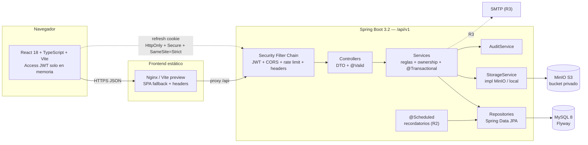
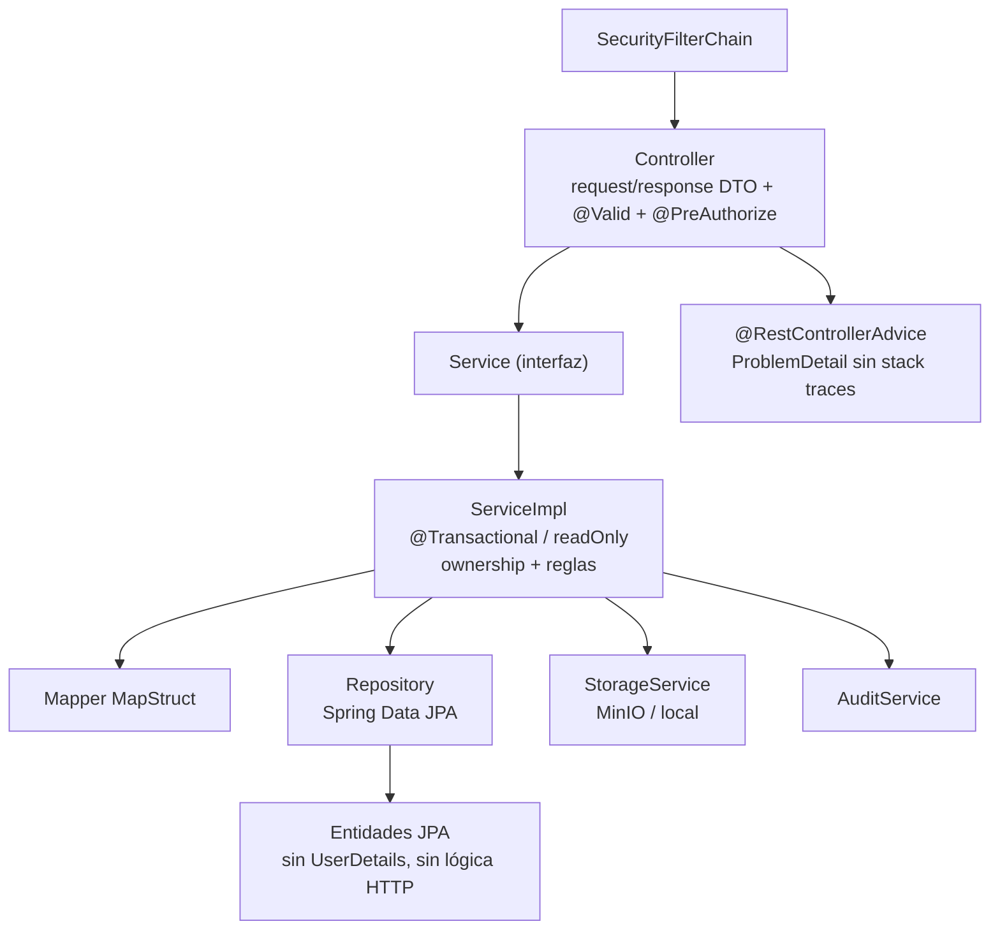
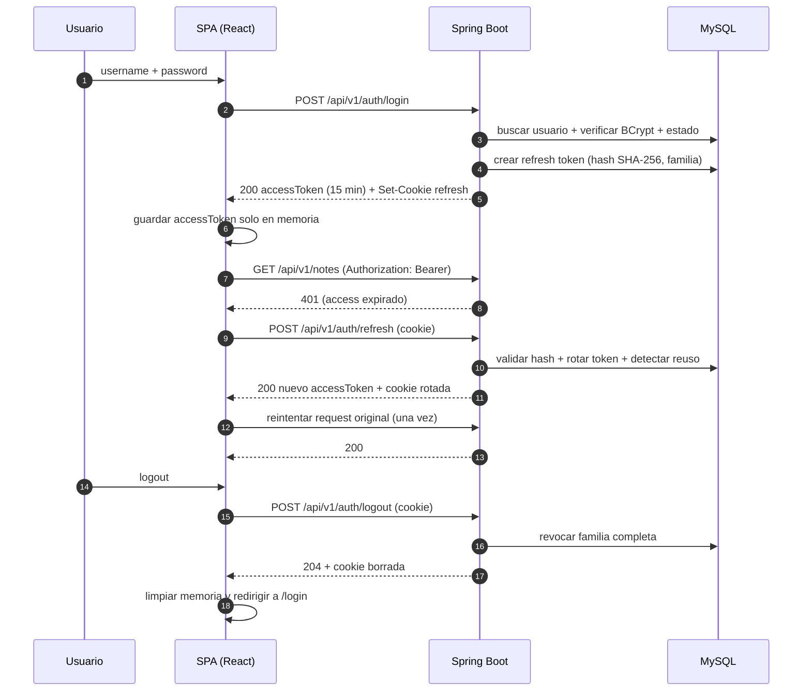

# PLAN — NotasApp: Agenda personal + archivador seguro

> **Versión:** 1.1 (v1.0 aprobada + 9 cambios de revisión).  
> **Repositorio:** `E:\PROYECTOS\Notas-app\NOTES-APP`  
> **Base analizada:** commit `e468817` + cambios locales sin commitear (`gradle/wrapper/gradle-wrapper.properties`, `AGENTS.md`, `README.md`, `tokens.css`).  
> **Fecha:** 2026-10-29.  
> **Alcance de esta sesión:** solo planificación. No se escribe código de la app ni se modifican archivos del repositorio.  
> **Nota de ubicación:** el presente archivo se guarda en el directorio de planes permitido por el entorno. Para llevarlo al repo, copiarlo a `NOTES-APP/PLAN.md` en una sesión de ejecución.

---

## 1. Diagnóstico del estado actual

### 1.1 Fuente de verdad e inventario real

Se priorizó el código sobre la documentación. No existe `NotasApp.txt`; el README real es `README.md` (300 líneas) y `AGENTS.txt` está vacío (0 bytes). El `AGENTS.md` de la raíz **no es genérico ni es de NotasApp: es el sistema de diseño del portfolio**; hay que **reemplazarlo**, no adaptarlo. El proyecto no tiene `frontend/AGENTS.md`, `docs/`, Docker, CI ni migraciones.

| Área | Inventario real | Estado |
|---|---|---|
| Backend | 27 archivos Java en `src/main/java/com/notasapp`: 3 entidades, 5 DTO, 3 controllers, 3 interfaces de servicio, 3 impl, 3 repositories, 2 clases de seguridad, 1 excepción, 3 config, 1 aplicación. | Funcional para CRUD básico; capas inconsistentes. |
| Backend tests | No existe `src/test`. | Cero cobertura. |
| Recursos backend | Solo `src/main/resources/application.properties`. Sin perfiles, sin Flyway, sin OpenAPI. | Configuración de desarrollo hardcodeada. |
| Frontend | CRA 5, JavaScript. `src/App.js` 1.275 líneas, `App.css` 1.099 líneas, `index.css` 98 líneas, 8 archivos en `src/`. | Monolito; sin router, sin componentes, sin temas. |
| Frontend tests | `App.test.js` busca "learn react"; `setupTests.js` presente. | Test roto desde el primer commit. |
| Raíz | `README.md`, `AGENTS.md` (del portfolio, no de NotasApp), `AGENTS.txt` vacío, `tokens.css` (163 líneas) huérfano, `build.gradle`, Gradle wrapper. | `AGENTS.md` hay que reemplazarlo; tokens no consumidos. |
| Infra | Sin `docker-compose.yml`, sin Dockerfiles, sin `.env.example`, sin `.github/`, sin `docs/adr/`. | No reproducible fuera de la máquina local. |
| Persistencia | MySQL 8 vía JPA; `ddl-auto=update`; sin migraciones versionadas. | Esquema derivado de entidades; riesgo de drift. |
| Seguridad | JWT HS256 de 24 h, token en `localStorage`, sin refresh, sin roles reales, CORS abierto, secretos en properties. | No apto para producción. |

### 1.2 Deuda técnica por severidad

#### Crítico

| ID | Hallazgo | Evidencia | Impacto |
|---|---|---|---|
| C-01 | Sin red de seguridad: no hay tests de backend y el único test de frontend está roto. | No existe `src/test`; `frontend/src/App.test.js:4-7` busca "learn react". | Cualquier refactor puede romper auth, ownership o datos sin detección. |
| C-02 | Build no reproducible por salto de Gradle incompatible con Spring Boot 3.2. | `gradle/wrapper/gradle-wrapper.properties:5` apunta a Gradle 9.7.1 (cambio local sin commit); `README.md:59` declara 8.14. Spring Boot 3.2 no soporta Gradle 9.x. | `./gradlew build` puede fallar o comportarse distinto en CI. |
| C-03 | Esquema sin versionado. | `src/main/resources/application.properties:13` (`ddl-auto=update`); no hay `db/migration`. | Pérdida de datos, drift entre entornos y despliegues no auditables. |
| C-04 | Contrato de registro roto y mass assignment. | `AuthController.java:45` recibe `@RequestBody Usuario`; `Usuario.java:52,67` expone `setId`/`setEnabled`; `dto/RegisterDTO.java` existe pero no se usa; `frontend/src/App.js:134-140` envía `nombre` y `rol` que el backend ignora. | Un atacante puede intentar sobrescribir otro usuario o habilitarse; el frontend pierde datos silenciosamente. |
| C-05 | Sesión no revocable y token persistido en el navegador. | `frontend/src/App.js:106-107` guarda `token` en `localStorage`; `application.properties:20` fija 86.400.000 ms (24 h); no hay refresh ni blacklist. | XSS exfiltra una credencial válida 24 h; logout solo borra el cliente (`App.js:471`). |

#### Alto

| ID | Hallazgo | Evidencia | Impacto |
|---|---|---|---|
| A-01 | Frontend monolítico y CRA deprecado. | `frontend/src/App.js` 1.275 líneas; `frontend/package.json:17` usa `react-scripts` 5; router instalado sin usar (`package.json:16`). | Difícil testear, navegar y mantener; deuda de tooling. |
| A-02 | Sistema de estilos duplicado y fuera de tokens. | `App.css:10-45` e `index.css:9-49` definen variables propias y contradictorias; `tokens.css` está en la raíz y no se importa; 32 declaraciones de color hardcodeadas y 96 medidas en px en `App.css`. | No hay tema claro/oscuro real ni consistencia visual; viola `AGENTS.md`. |
| A-03 | DTOs sin validación ni separación request/response. | `NotaController.java:61,70` y `CategoriaController.java:39,47` usan `@RequestBody` sin `@Valid`; `NotaDTO` no tiene constraints; `LoginDTO` no valida; `CategoriaDTO.cantidadNotas` se calcula y no se usa. | Datos inválidos llegan al servicio; over-posting de campos de servidor. |
| A-04 | Sin manejo global de errores. | Solo `ResourceNotFoundException.java:6`; no hay `@RestControllerAdvice`. `NotaServiceImpl.java:62,90,102,138,152` lanza `RuntimeException` para denegar ownership. | Respuestas 500 en vez de 403/404; posibles mensajes internos y formatos inconsistentes. |
| A-05 | Mapeo manual y consultas N+1. | `NotaServiceImpl.java:169-186` y `CategoriaServiceImpl.java:128-141` mapean a mano; `CategoriaServiceImpl.java:136-137` recorre `getNotas().size()` por categoría; `open-in-view` queda en `true` por defecto. | Duplicación, errores de contrato y degradación con muchas notas. |
| A-06 | Sin paginación ni búsqueda server-side. | `I_NotaRepository.java:16-27` devuelve `List`; `NotaController.java:35-48` lista todo; el frontend filtra en memoria (`App.js:494-510`). | Performance y memoria no escalan; búsqueda incompleta. |
| A-07 | Sin soft delete ni auditoría. | `NotaServiceImpl.java:93` ejecuta `delete` físico; no hay `deleted_at`, `audit_log` ni eventos. | Pérdida irreversible y sin trazabilidad. |
| A-08 | Sin tags, adjuntos, cuotas, MinIO ni recordatorios. | No existen entidades, tablas ni servicios; no hay dependencia de storage. | El reposicionamiento "archivador seguro" no está implementado. |
| A-09 | Transacciones sin intención de lectura. | `NotaServiceImpl.java:20`, `CategoriaServiceImpl.java:15`, `UsuarioServiceImpl.java:15` usan `@Transactional` de clase. | Escrituras/locks innecesarios en lecturas. |
| A-10 | Sin OpenAPI, sin perfiles y sin observabilidad. | No hay springdoc, `application-dev.yml`/`application-prod.yml`, Actuator ni logs estructurados. | API no documentada; imposible operar en prod. |
| A-11 | Temas y accesibilidad ausentes. | `frontend/public/index.html:1-43` es la plantilla CRA (título "React App", sin anti-FOUC); no hay `data-theme`; modales son `div` sin `role="dialog"` (`App.js:1041-1043`, `1133-1135`, `1205-1207`); foco con `:focus` y no `:focus-visible` (`index.css:91-98`). | No cumple AA ni la decisión de dos temas. |

#### Medio

| ID | Hallazgo | Evidencia | Impacto |
|---|---|---|---|
| M-01 | Configuración solo-dev mezclada con producción. | `application.properties:7,9,13,14,16,19,23-25,31`; `allow-circular-references=true`; H2 console permitido sin H2 (`SecurityConfig.java:32`). | Riesgo de desplegar flags inseguros. |
| M-02 | Repositorios sin `EntityGraph` ni proyecciones. | `I_NotaRepository.java:25-27` usa entidad como parámetro; no hay `@EntityGraph`. | Lazy loading inesperado y N+1. |
| M-03 | Fechas y estados mutados en setters. | `Nota.java:45-46` inicializa en constructor; `:73,82,107,123` actualizan `fechaActualizacion` desde setters. | Efectos secundarios ocultos, difícil testear y serializar. |
| M-04 | `equals/hashCode` mutables. | `Categoria.java:108-130` usa `nombre` cuando `id` es null. | Corrupción de `HashSet` si cambia el nombre antes de persistir. |
| M-05 | Nomenclatura y paquetes inconsistentes. | `I_UsuarioService`, `I_NotaRepository`, mezcla español/inglés (`fechaCreacion`, `username`), `service/impl`. | Fricción para MapStruct y convenciones. |
| M-06 | Código muerto. | `LoginResponseDTO`, `I_NotaService.listarTodasNotas`, bean `AuthenticationManager` sin uso, `buscarCategorias`/`obtenerCategoriasPorColor` no expuestos. | Ruido y falsas expectativas. |
| M-07 | Frontend sin cliente HTTP ni manejo de 401. | Cada llamada repite `Authorization` (`App.js:175,236,274,316,436`); no hay interceptor; `console.log` con datos (`App.js:190,202,286,325,403`). | Difícil migrar a refresh; filtra información en consola. |
| M-08 | Datos ficticios y roles inferidos en el cliente. | `App.js:290-299` inventa una nota si falla la carga; `App.js:97-104` inventa email y rol desde el username; `App.js:30-33` precarga admin/admin123. | La UI miente y normaliza un backdoor de demo. |
| M-09 | Dependencias externas de fuente. | `index.css:1` y `App.css:2` importan Google Fonts. | Privacidad, performance y fuente fuera de tokens. |
| M-10 | Documentación de frontend es boilerplate. | `frontend/README.md` es el README de CRA. | No explica la app ni sus scripts reales. |
| M-11 | `.idea` parcialmente trackeado y archivos vacíos. | `git ls-files .idea` lista 6 archivos; `AGENTS.txt` 0 bytes; `tokens.css` huérfano. | Ruido de repo y configuración de IDE compartida. |

#### Bajo

| ID | Hallazgo | Evidencia | Impacto |
|---|---|---|---|
| B-01 | Encoding inconsistente en fuentes y properties. | `application.properties:6,30` muestra `Crear�`, `despu�s`; comentarios Java con emojis. | Diffs sucios y posibles fallos de compilación en otras plataformas. |
| B-02 | Sin formato/lint de backend. | No hay Checkstyle, Spotless ni `.editorconfig`. | Estilo variable. |
| B-03 | Manifest y metadatos CRA. | `frontend/public/manifest.json`, `index.html` con `theme-color #000000`. | PWA y metadatos incorrectos. |
| B-04 | Sin licencia ni ADRs. | No hay `LICENSE`, `docs/adr`. | Menos claridad para portfolio. |

### 1.3 Riesgos de seguridad con archivo y línea

| ID | Severidad | Riesgo | Evidencia exacta | Consecuencia |
|---|---|---|---|---|
| S-01 | Crítico | Secretos versionados y reutilizables. | `application.properties:9` (`password=[REDACTED]`), `:19` (`jwt.secret=[REDACTED] Ambos están en el historial de git. | Cualquiera con el repo puede abrir la DB o firmar JWTs. Rotar ambos y asumirlos comprometidos. |
| S-02 | Crítico | Mass assignment en registro. | `AuthController.java:45` bindea `Usuario`; `Usuario.java:52,67` permiten `id` y `enabled`. | Escritura sobre otra cuenta o bypass de estado. |
| S-03 | Crítico | Token de acceso en `localStorage`. | `App.js:106-107`; lecturas en `:175,236,274,316,436`; logout `:471`. | XSS roba sesión de 24 h; no hay revocación. |
| S-04 | Crítico | CORS comodín con credenciales. | `CorsConfig.java:16-20` (`allowedOriginPatterns("*")`, `allowCredentials(true)`). | Cualquier origen puede invocar la API con cookies; incompatible con refresh cookie. |
| S-05 | Crítico | Roles inexistentes; admin solo visual. | `Usuario.java:79-81` devuelve lista vacía; `App.js:103,226` infiere `ADMIN` por username; `CategoriaController.java:38-60` no tiene `@PreAuthorize`. | Cualquier usuario autenticado administra categorías. |
| S-06 | Crítico | Sin refresh, rotación ni revocación. | No hay entidad/tabla; `application.properties:20` 24 h; logout solo cliente. | Token robado válido hasta 24 h; no se puede cerrar sesión en servidor. |
| S-07 | Alto | Enumeración de usuarios y fuerza bruta. | `UsuarioServiceImpl.java:50-55` distingue "Usuario no encontrado" de "Contraseña incorrecta"; sin rate limit ni lockout. | Descubrimiento de cuentas y ataques de diccionario. |
| S-08 | Alto | Errores de auth filtran internos. | `AuthController.java:39,59` devuelven `e.getMessage()`. | Fuga de detalles de implementación/DB. |
| S-09 | Alto | Filtro JWT no resiliente. | `JwtAuthenticationFilter.java:39-47` no captura `JwtException`; token malformado/expirado puede cortar la cadena. | 500 en vez de 401; ruido y posible stack trace. |
| S-10 | Alto | Backdoor de demo en cada arranque. | `DatabaseConfig.java:33-43,51-58` crea `admin/admin123` y `usuario/usuario123` y las imprime. | Credenciales públicas en producción si no se elimina el seed. |
| S-11 | Alto | Sin headers de seguridad ni estrategia CSRF. | `SecurityConfig.java:28` desactiva CSRF; no hay HSTS, CSP, `X-Content-Type-Options`, `Referrer-Policy` ni `frameOptions`. | Defensa en profundidad insuficiente; el refresh cookie exigirá controles. |
| S-12 | Alto | Sin rate limiting en `/auth/**`. | No hay filtro ni dependencia. | Registro/login/refresh ilimitados. |
| S-13 | Medio | Errores de ownership como 500. | `NotaServiceImpl.java:62,90,102,138,152`. | No hay IDOR directo, pero se filtran mensajes y se rompe el contrato. |
| S-14 | Medio | Logging verboso con datos. | `application.properties:23-25`; `App.js:190,202,286,325,403`. | Posible PII/tokens en logs y consola. |
| S-15 | Medio | Categorías globales sin ownership ni rol. | `Categoria.java:24-25`; `CategoriaServiceImpl.java` no recibe usuario; `CategoriaController.java:38-60`. | Un usuario modifica la taxonomía de todos. |

### 1.4 README/documentación vs código

| Afirmación documental | Código real | Prioridad |
|---|---|---|
| El prompt menciona `NotasApp.txt`. | No existe; el README es `README.md` y `AGENTS.txt` está vacío. | Documentar el nombre correcto. |
| `README.md:59` declara Gradle Wrapper 8.14. | `gradle/wrapper/gradle-wrapper.properties:5` tiene 9.7.1 (cambio local). | Código/wrapper manda; pinear 8.14. |
| `README.md:160` describe token de 24 h. | `application.properties:20` = 86.400.000 ms. | Correcto hoy; el objetivo son 15 min + refresh. |
| `README.md:163` dice que solo `/api/auth/**` es público. | `SecurityConfig.java:31-32` también permite `/error` y `/h2-console/**`. | Código manda; eliminar H2. |
| `README.md:165` dice que el frontend guarda token en `localStorage`. | `App.js:106-107`. | Correcto; es deuda a eliminar. |
| `README.md:221` describe el fallback a `/api/categorias/todas`. | `App.js:183` lo intenta; el endpoint no existe. | Correcto; eliminar el fallback muerto. |
| `README.md:242` dice que registro envía `nombre` y `rol`. | `App.js:134-140` los envía; el backend los ignora. | Correcto; alinear contrato. |
| `README.md:295` denuncia CORS abierto. | `CorsConfig.java:16-20`. | Correcto; es lo primero a corregir. |

**Conclusión:** el backend demuestra el dominio, pero no cumple el estándar de producción. La prioridad no es agregar features sino cerrar seguridad, contratos, esquema y build; luego reconstruir el frontend sobre TypeScript, tokens y router.

---

## 2. Arquitectura objetivo

### 2.1 Principios

- **Monolito modular** Spring Boot 3.2 + Java 17, sin microservicios.
- **API versionada** en `/api/v1`; frontend y backend desacoplados por contrato.
- **Stateless** para access token; el único estado de sesión persistente es el refresh token en MySQL.
- **DTO-only** en controllers; entidades JPA nunca cruzan la frontera HTTP.
- **UTC en persistencia**, ISO-8601 en API; la zona horaria del usuario se aplica solo en presentación (R2).
- **Fail-closed** en validación de archivos, autorización y cuotas.

### 2.2 Diagrama de componentes



### 2.3 Capas backend



Regla dura: `Controller → Service → Repository`. Un controller no importa `com.notasapp.repository.*` ni `com.notasapp.model.*`; un repository no conoce DTOs.

### 2.4 Flujo de autenticación



**Paso a paso y reglas**

1. `POST /auth/login` valida credenciales con BCrypt y estado (`enabled`, `locked_until`). Si el usuario no existe, ejecuta igual un BCrypt contra un hash dummy para no filtrar timing.
2. El backend emite un access JWT HS256 de 15 min con `sub` (id), `usr`, `roles`, `iss`, `aud`, `iat`, `exp`, `jti`. No incluye refresh.
3. El refresh token es opaco (32 bytes aleatorios, base64url). En DB solo se guarda `SHA-256(token)`; nunca el valor plano.
4. La cookie se llama `__Host-notasapp_rt`, con `HttpOnly`, `Secure` (en prod), `SameSite=Strict`, `Path=/`, sin `Domain`. En dev se permite `Secure=false` solo con perfil `dev` y advertencia explícita.
5. Cada refresh rota el token: marca el anterior `revoked_at`, crea uno nuevo en la misma `family_id` y enlaza `replaced_by_id`.
6. Si se presenta un token ya revocado, se revoca toda la familia y se responde 401. El frontend descarta la sesión. No hay "gracia" para reuso.
7. El frontend serializa los refresh (single-flight) con una cola de requests pendientes y coordinación entre pestañas por `BroadcastChannel`. Un 401 de `/auth/*` no dispara refresh.
8. El access token vive en una variable de módulo (`authStore`) y en memoria de React; nunca en `localStorage`, `sessionStorage`, cookies no-HttpOnly, IndexedDB ni URL.
9. Al recargar la página, `AuthProvider` llama una vez a `/auth/refresh`; si falla, estado `anonymous` y ruta `/login`.
10. `logout` revoca la familia, borra la cookie y limpia memoria; si la red falla, el cliente limpia igual y el token expira por TTL.

### 2.5 Topología de despliegue

- **Dev:** Vite en `:5173` con proxy `/api` → `:8080`; MySQL `:3306`; MinIO `:9000`/`:9001`; backend con perfil `dev`.
- **Prod (compose):** Nginx sirve `dist` y hace proxy `/api` al backend; MySQL y MinIO en red interna sin puertos públicos; backend con perfil `prod`, Swagger off, CORS exacto y cookies `Secure`.
- **Same-site (decisión cerrada):** frontend y API comparten el mismo dominio registrable (`app.notasapp.com` y `api.notasapp.com`). El refresh usa `SameSite=Strict`; no se emite CSRF token. `BE-10b` (double-submit para dominio cruzado) **no se ejecuta**. La decisión y sus condiciones de revisión quedan en **ADR-0008**.

---

## 3. Modelo de datos objetivo

### 3.1 Convenciones

- Claves `BIGINT AUTO_INCREMENT`; nombres de tabla/columna en `snake_case`; Java en `camelCase`.
- Fechas `DATETIME(6)` en UTC; Hibernate `hibernate.jdbc.time_zone=UTC`; Java `Instant`.
- Soft delete con `deleted_at`; los repositorios filtran `deleted_at IS NULL`.
- Toda FK tiene índice; todo `UNIQUE` se declara en DB, no solo en JPA.
- `created_at`/`updated_at` los gestiona JPA (`@CreationTimestamp`/`@UpdateTimestamp`) o un `@MappedSuperclass`, nunca setters de negocio.
- `@Version` en `notas` para concurrencia optimista; `PUT` con versión desactualizada → 409.

### 3.2 Tablas core

#### `usuarios`

| Campo | Tipo | Restricciones |
|---|---|---|
| `id` | BIGINT | PK, AUTO_INCREMENT |
| `username` | VARCHAR(50) | NOT NULL, UNIQUE (`uk_usuarios_username`) |
| `email` | VARCHAR(254) | NOT NULL, UNIQUE (`uk_usuarios_email`) |
| `password_hash` | VARCHAR(100) | NOT NULL (BCrypt) |
| `nombre` | VARCHAR(80) | NULL |
| `enabled` | BOOLEAN | NOT NULL DEFAULT TRUE |
| `failed_attempts` | SMALLINT | NOT NULL DEFAULT 0 |
| `locked_until` | DATETIME(6) | NULL |
| `created_at` | DATETIME(6) | NOT NULL |
| `updated_at` | DATETIME(6) | NOT NULL |
| `deleted_at` | DATETIME(6) | NULL |

Índices: `uk_usuarios_username`, `uk_usuarios_email`, `idx_usuarios_deleted_at`.

#### `roles` y `usuario_roles`

| Tabla | Campo | Tipo | Restricciones |
|---|---|---|---|
| `roles` | `id` | SMALLINT | PK |
| `roles` | `nombre` | VARCHAR(20) | NOT NULL, UNIQUE; seed `USER`, `ADMIN` |
| `usuario_roles` | `usuario_id` | BIGINT | PK compuesta, FK → `usuarios(id)` |
| `usuario_roles` | `role_id` | SMALLINT | PK compuesta, FK → `roles(id)` |

Índices: `idx_usuario_roles_role_id`. `ON DELETE CASCADE` en ambas FKs.

#### `refresh_tokens`

| Campo | Tipo | Restricciones |
|---|---|---|
| `id` | BIGINT | PK |
| `usuario_id` | BIGINT | NOT NULL, FK → `usuarios(id)` |
| `token_hash` | CHAR(64) | NOT NULL, UNIQUE (`uk_refresh_token_hash`) |
| `family_id` | CHAR(36) | NOT NULL |
| `issued_at` | DATETIME(6) | NOT NULL |
| `expires_at` | DATETIME(6) | NOT NULL |
| `revoked_at` | DATETIME(6) | NULL |
| `replaced_by_id` | BIGINT | NULL, FK → `refresh_tokens(id)` |
| `user_agent` | VARCHAR(255) | NULL |
| `ip` | VARCHAR(45) | NULL |
| `created_at` | DATETIME(6) | NOT NULL |

Índices: `uk_refresh_token_hash`, `idx_refresh_usuario`, `idx_refresh_family`, `idx_refresh_expires`. Retención: purgar revocados/expirados > 30 días con job.

#### `notas`

| Campo | Tipo | Restricciones |
|---|---|---|
| `id` | BIGINT | PK |
| `usuario_id` | BIGINT | NOT NULL, FK → `usuarios(id)` |
| `titulo` | VARCHAR(200) | NOT NULL |
| `contenido` | MEDIUMTEXT | NULL |
| `archivada` | BOOLEAN | NOT NULL DEFAULT FALSE |
| `version` | BIGINT | NOT NULL DEFAULT 0 (`@Version`) |
| `created_at` | DATETIME(6) | NOT NULL |
| `updated_at` | DATETIME(6) | NOT NULL |
| `deleted_at` | DATETIME(6) | NULL |
| `fecha_vencimiento` | DATETIME(6) | NULL (R2) |
| `prioridad` | TINYINT | NOT NULL DEFAULT 2 (R2: 1 alta, 2 media, 3 baja) |
| `estado` | VARCHAR(20) | NOT NULL DEFAULT `PENDIENTE` (R2) |

Índices: `idx_notas_usuario_archivada_deleted (usuario_id, archivada, deleted_at)`, `idx_notas_usuario_updated (usuario_id, updated_at)`, `FULLTEXT ft_notas_titulo_contenido (titulo, contenido)`, R2: `idx_notas_usuario_vencimiento (usuario_id, fecha_vencimiento)`.

#### `categorias` y `nota_categoria`

| Campo | Tipo | Restricciones |
|---|---|---|
| `categorias.id` | BIGINT | PK |
| `categorias.usuario_id` | BIGINT | NOT NULL, FK → `usuarios(id)` |
| `categorias.nombre` | VARCHAR(50) | NOT NULL |
| `categorias.color` | CHAR(7) | NOT NULL, formato `#RRGGBB` |
| `categorias.descripcion` | VARCHAR(500) | NULL |
| `categorias.created_at` | DATETIME(6) | NOT NULL |
| `categorias.updated_at` | DATETIME(6) | NOT NULL |
| `categorias.deleted_at` | DATETIME(6) | NULL |
| `nota_categoria.nota_id` | BIGINT | PK compuesta, FK → `notas(id)` |
| `nota_categoria.categoria_id` | BIGINT | PK compuesta, FK → `categorias(id)` |

Índices: `uk_categorias_usuario_nombre (usuario_id, nombre)`, `idx_nota_categoria_categoria_id`. Decisión: categorías **por usuario** (no globales) para que el ownership sea uniforme; se documenta en ADR-0005. Como la DB se recrea, no hay clonado legacy: V6 crea la estructura y `INF-04b` verifica que no queden vínculos entre dueños distintos. Nota: un nombre borrado lógicamente queda reservado por el unique hasta la purga física; se documenta en el runbook.

#### `tags` y `nota_tag`

| Campo | Tipo | Restricciones |
|---|---|---|
| `tags.id` | BIGINT | PK |
| `tags.usuario_id` | BIGINT | NOT NULL, FK → `usuarios(id)` |
| `tags.nombre` | VARCHAR(50) | NOT NULL |
| `tags.created_at` | DATETIME(6) | NOT NULL |
| `tags.deleted_at` | DATETIME(6) | NULL |
| `nota_tag.nota_id` | BIGINT | PK compuesta, FK → `notas(id)` |
| `nota_tag.tag_id` | BIGINT | PK compuesta, FK → `tags(id)` |

Índices: `uk_tags_usuario_nombre (usuario_id, nombre)`, `idx_nota_tag_tag_id`. Misma regla de nombre reservado que categorías.

#### `adjuntos`

| Campo | Tipo | Restricciones |
|---|---|---|
| `id` | BIGINT | PK |
| `nota_id` | BIGINT | NOT NULL, FK → `notas(id)` |
| `usuario_id` | BIGINT | NOT NULL, FK → `usuarios(id)` |
| `nombre_original` | VARCHAR(255) | NOT NULL |
| `storage_key` | VARCHAR(512) | NOT NULL, UNIQUE (`uk_adjuntos_storage_key`) |
| `mime_type` | VARCHAR(100) | NOT NULL |
| `tamano_bytes` | BIGINT | NOT NULL, CHECK > 0 |
| `checksum_sha256` | CHAR(64) | NOT NULL |
| `estado` | VARCHAR(20) | NOT NULL DEFAULT `READY` (`PENDING`, `READY`, `DELETED`) |
| `created_at` | DATETIME(6) | NOT NULL |
| `deleted_at` | DATETIME(6) | NULL |
| `scan_status` (R3) | VARCHAR(20) | NULL (`PENDING`, `SCANNING`, `READY`, `INFECTED`, `ERROR`) |
| `scan_engine` / `scan_error` (R3) | VARCHAR(50) / VARCHAR(500) | NULL |
| `scanned_at` (R3) | DATETIME(6) | NULL |

Índices: `idx_adjuntos_nota`, `idx_adjuntos_usuario`, `uk_adjuntos_storage_key`, `idx_adjuntos_checksum` (opcional para dedupe futuro), R3: `idx_adjuntos_scan_status`.

#### `audit_log`

| Campo | Tipo | Restricciones |
|---|---|---|
| `id` | BIGINT | PK |
| `usuario_id` | BIGINT | NULL, FK → `usuarios(id)` ON DELETE SET NULL |
| `accion` | VARCHAR(50) | NOT NULL (p. ej. `LOGIN_SUCCESS`, `NOTE_DELETE`, `ATTACHMENT_UPLOAD`, `ADMIN_ROLE_CHANGE`) |
| `entidad` | VARCHAR(50) | NULL |
| `entidad_id` | BIGINT | NULL |
| `ip` | VARCHAR(45) | NULL |
| `user_agent` | VARCHAR(255) | NULL |
| `detalle` | JSON | NULL (solo campos whitelist; nunca password/token/contenido) |
| `created_at` | DATETIME(6) | NOT NULL |

Índices: `idx_audit_usuario_created (usuario_id, created_at)`, `idx_audit_entidad (entidad, entidad_id)`, `idx_audit_accion_created (accion, created_at)`. Append-only; sin `updated_at`.

### 3.3 Tablas R2/R3

| Release | Tabla | Campos clave | Índices |
|---|---|---|---|
| R2 | `recordatorios` | `id`, `nota_id`, `usuario_id`, `recordar_at`, `enviado_at`, `estado`, `created_at` | `(recordar_at, estado)`, `(usuario_id, recordar_at)` |
| R2 | `notificaciones` | `id`, `usuario_id`, `tipo`, `payload JSON`, `leida_at`, `created_at` | `(usuario_id, leida_at)` |
| R3 | `two_factor` | `usuario_id` PK, `secret_encrypted`, `recovery_codes_hash`, `enabled_at` | PK |
| R3 | `account_tokens` | `id`, `usuario_id`, `tipo`, `token_hash`, `expires_at`, `used_at`, `created_at` | `uk_token_hash`, `(usuario_id, tipo)` |
| R3 | `shared_links` | `id`, `nota_id`, `token_hash`, `expires_at`, `revoked_at`, `created_at` | `uk_shared_token_hash`, `(nota_id)` |

### 3.4 Migraciones Flyway

`spring.flyway.locations=classpath:db/migration` en prod; en dev se agrega `classpath:db/seed`. La DB actual se **recrea** por decisión (no hay migración de datos legacy); `baseline-on-migrate` no es necesario. El seed de demo nunca corre en prod.

| Versión | Archivo | Release | Qué hace |
|---|---|---|---|
| V1 | `V1__baseline_current_schema.sql` | R1 | Crea el esquema actual exacto (`usuarios`, `categorias`, `notas`, `nota_categoria`) con índices de FK y `username`/`email`; permite que la app legacy siga arrancando. |
| V2 | `V2__roles.sql` | R1 | Crea `roles` y `usuario_roles`; seed `USER`/`ADMIN`. En dev, `R__dev_seed.sql` crea `admin` y su fila en `usuario_roles`; en prod, `BootstrapAdminRunner` crea el primer `ADMIN` desde `BOOTSTRAP_ADMIN_*` solo si no existe ninguno. |
| V3 | `V3__usuarios_hardening.sql` | R1 | Agrega `nombre`, `failed_attempts`, `locked_until`, `created_at`, `updated_at`, `deleted_at`; renombra `password` → `password_hash`; backfill de timestamps. |
| V4 | `V4__refresh_tokens.sql` | R1 | Crea `refresh_tokens` con hash, familia, rotación y revocación. |
| V5 | `V5__notas_soft_delete_audit.sql` | R1 | Renombra `fecha_creacion`/`fecha_actualizacion` a `created_at`/`updated_at`; agrega `version`, `deleted_at`; backfill. |
| V6 | `V6__categorias_por_usuario.sql` | R1 | Agrega `usuario_id`, `created_at`, `updated_at`, `deleted_at`; **elimina el unique global de `nombre`** y crea `uk_categorias_usuario_nombre (usuario_id, nombre)`; sin backfill legacy (DB recreada). `INF-04b` verifica invariantes de ownership. |
| V7 | `V7__tags.sql` | R1 | Crea `tags` y `nota_tag`. |
| V8 | `V8__adjuntos.sql` | R1 | Crea `adjuntos` con checksum, storage key y estado. |
| V9 | `V9__audit_log.sql` | R1 | Crea `audit_log` append-only. |
| V10 | `V10__fulltext_notas.sql` | R1 | Crea `FULLTEXT ft_notas_titulo_contenido (titulo, contenido)` en InnoDB. |
| V11 | `V11__agenda_fields.sql` | R2 | Agrega `fecha_vencimiento`, `prioridad`, `estado` a `notas` e índices de agenda. |
| V12 | `V12__recordatorios_notificaciones.sql` | R2 | Crea `recordatorios` y `notificaciones`. |
| V13 | `V13__two_factor.sql` | R3 | Crea `two_factor`. |
| V14 | `V14__account_tokens.sql` | R3 | Crea `account_tokens` para verificación/reset. |
| V15 | `V15__shared_links.sql` | R3 | Crea `shared_links`. |
| V16 | `V16__attachment_scan.sql` | R3 | Agrega `scan_status`, `scan_engine`, `scan_error`, `scanned_at` e índice a `adjuntos` para ClamAV. |
| R__ | `R__dev_seed.sql` | Dev | Seed idempotente de usuarios demo, categorías y notas de ejemplo; solo en `db/seed` (perfil dev). |

**Reset de DB (decisión cerrada):** la DB actual es de demo y **se recrea**; no se migran datos legacy. Antes de V1 se hace un `mysqldump` de cortesía fuera del repo. No se usa `ddl-auto=update` en ningún perfil. `INF-04b` valida las invariantes de V6 en la DB nueva.

### 3.5 Reglas de integridad

- `notas.usuario_id` con `ON DELETE RESTRICT`; el borrado de usuario es soft delete y revoca refresh tokens.
- `adjuntos.nota_id` con `ON DELETE RESTRICT`; el soft delete de nota conserva adjuntos hasta purga explícita.
- `nota_categoria`/`nota_tag` con `ON DELETE CASCADE` al hard delete físico de la nota (solo mantenimiento/admin).
- Checks en servicio: cuota por archivo, por nota y total; ownership antes de cualquier escritura; `deleted_at IS NULL` en todas las lecturas.

---

## 4. Contratos de API

### 4.0 Convenciones

- Base: `/api/v1`. JSON UTF-8. Fechas ISO-8601 UTC (`2026-10-29T14:05:00Z`).
- Auth: `Authorization: Bearer <access>`; refresh solo por cookie.
- Roles: `Público`, `USER`, `ADMIN`. Ownership: `USER` propietario del recurso.
- Paginación: `page` (0-based), `size` (1–100, default 20), `sort` con whitelist por recurso.
- Errores: RFC 7807 `application/problem+json` con `type`, `title`, `status`, `detail`, `instance`, `code`, `errors[]`. Nunca stack traces.
- `404` también se usa para recursos de otro usuario (anti-enumeración); `403` solo para rol insuficiente.

### 4.1 DTOs de entrada y validaciones

| DTO | Campos y validaciones |
|---|---|
| `RegisterRequest` | `username` `@NotBlank @Size(3,50) @Pattern("^[A-Za-z0-9._-]+$")`; `email` `@NotBlank @Email @Size(max=254)`; `password` `@NotBlank @Size(10,72)` con al menos mayúscula, minúscula y dígito; `nombre` `@Size(max=80)`. |
| `LoginRequest` | `username` `@NotBlank @Size(max=50)`; `password` `@NotBlank @Size(max=72)`. |
| `ChangePasswordRequest` | `currentPassword` `@NotBlank`; `newPassword` `@NotBlank @Size(10,72)` + complejidad + distinto del actual. |
| `UpdateProfileRequest` | `nombre` `@Size(max=80)`; `email` `@Email @Size(max=254)`. |
| `DeleteAccountRequest` | `password` `@NotBlank`. |
| `NoteCreateRequest` | `titulo` `@NotBlank @Size(1,200)`; `contenido` `@Size(max=100000)`; `categoriaIds` `@Size(max=20)`; `tagIds` `@Size(max=30)`. |
| `NoteUpdateRequest` | Todos los de create + `version` `@NotNull @PositiveOrZero` para concurrencia optimista. |
| `NoteAgendaRequest` (R2) | `fechaVencimiento` `@FutureOrPresent`; `prioridad` `@Min(1) @Max(3)`; `estado` enum `PENDIENTE/EN_CURSO/HECHA`. |
| `CategoryRequest` | `nombre` `@NotBlank @Size(1,50)`; `color` `@Pattern("^#[0-9A-Fa-f]{6}$")`; `descripcion` `@Size(max=500)`. |
| `TagRequest` | `nombre` `@NotBlank @Size(1,50) @Pattern("^[\\p{L}0-9 _-]+$")`. |
| `AdminUserEnabledRequest` | `enabled` `@NotNull`. |
| `AdminUserRolesRequest` | `roles` `@NotEmpty` con valores `USER`/`ADMIN`. |
| `AttachmentResponse` | `id`, `nombreOriginal`, `mimeType`, `tamanoBytes`, `checksumSha256`, `createdAt`, `downloadUrl` (no persistido). |

Respuestas: `UserResponse` (`id`, `username`, `email`, `nombre`, `roles`, `createdAt`), `AuthResponse` (`accessToken`, `tokenType`, `expiresIn`, `user`), `PageResponse<T>` (`content`, `page`, `size`, `totalElements`, `totalPages`), `NoteSummaryResponse` (`id`, `titulo`, `extracto`, `archivada`, `categorias`, `tags`, `updatedAt`), `NoteResponse` (todo + `contenido`, `version`), `CategoryResponse`, `TagResponse`, `AuditResponse`, `AdminStatsResponse`.

### 4.2 Auth — `/api/v1/auth`

| Método | Ruta | Rol | Request | Response | Errores |
|---|---|---|---|---|---|
| POST | `/register` | Público | `RegisterRequest` | `201 UserResponse` | 400, 409, 429 |
| POST | `/login` | Público | `LoginRequest` | `200 AuthResponse` + `Set-Cookie` | 400, 401, 423, 429 |
| POST | `/refresh` | Público (cookie) | — | `200 AuthResponse` + cookie rotada | 401, 429 |
| POST | `/logout` | USER | — | `204` + cookie borrada | 401 |
| GET | `/me` | USER | — | `200 UserResponse` | 401 |
| GET | `/status` | Público | — | `200 {status, timestamp}` | — |

Reglas: login genérico "Credenciales inválidas" para usuario inexistente o password incorrecta; lockout 5 fallos/15 min → 423; rate limit por IP+username. `refresh` y `logout` validan `Origin` contra la allowlist y exigen cookie; nunca aceptan token en body.

### 4.3 Usuarios — `/api/v1/users`

| Método | Ruta | Rol | Request | Response | Errores |
|---|---|---|---|---|---|
| GET | `/me` | USER | — | `200 UserResponse` | 401 |
| PATCH | `/me` | USER | `UpdateProfileRequest` | `200 UserResponse` | 400, 401, 409 |
| PUT | `/me/password` | USER | `ChangePasswordRequest` | `204` | 400, 401, 422 |
| DELETE | `/me` | USER | `DeleteAccountRequest` | `204` (soft delete + revoca tokens) | 401, 422 |

### 4.4 Notas — `/api/v1/notes`

| Método | Ruta | Rol | Request | Response | Errores |
|---|---|---|---|---|---|
| GET | `/` | USER | query `page,size,sort,archived,q,categoryId,tagId` | `200 PageResponse<NoteSummaryResponse>` | 400, 401 |
| GET | `/{id}` | USER owner | — | `200 NoteResponse` | 401, 404 |
| POST | `/` | USER | `NoteCreateRequest` | `201 NoteResponse` | 400, 401, 404 (cat/tag), 422 |
| PUT | `/{id}` | USER owner | `NoteUpdateRequest` | `200 NoteResponse` | 400, 401, 404, 409 (versión) |
| DELETE | `/{id}` | USER owner | — | `204` (soft delete) | 401, 404 |
| PATCH | `/{id}/archive` | USER owner | — | `200 NoteResponse` | 401, 404 |
| PATCH | `/{id}/unarchive` | USER owner | — | `200 NoteResponse` | 401, 404 |
| GET | `/search` | USER | `q` `@Size(1,100)`, `page,size` | `200 PageResponse<NoteSummaryResponse>` | 400, 401 |
| GET | `/agenda` (R2) | USER | `from`, `to` | `200 PageResponse<NoteSummaryResponse>` | 400, 401 |
| GET | `/today` (R2) | USER | — | `200 List<NoteSummaryResponse>` | 401 |
| GET | `/upcoming` (R2) | USER | `days` 1–30, default 7 | `200 List<NoteSummaryResponse>` | 400, 401 |
| PATCH | `/{id}/agenda` (R2) | USER owner | `NoteAgendaRequest` | `200 NoteResponse` | 400, 401, 404, 409 |

Búsqueda: `MATCH ... AGAINST` en boolean mode para `q` de 3+ caracteres; fallback `LIKE` para 1–2; solo notas propias y no eliminadas.

### 4.5 Categorías — `/api/v1/categories`

| Método | Ruta | Rol | Request | Response | Errores |
|---|---|---|---|---|---|
| GET | `/` | USER | — | `200 List<CategoryResponse>` | 401 |
| GET | `/{id}` | USER owner | — | `200 CategoryResponse` | 401, 404 |
| POST | `/` | USER | `CategoryRequest` | `201 CategoryResponse` | 400, 401, 409 |
| PUT | `/{id}` | USER owner | `CategoryRequest` | `200 CategoryResponse` | 400, 401, 404, 409 |
| DELETE | `/{id}` | USER owner | — | `204` o `409` si tiene notas | 401, 404, 409 |

### 4.6 Tags — `/api/v1/tags`

| Método | Ruta | Rol | Request | Response | Errores |
|---|---|---|---|---|---|
| GET | `/` | USER | — | `200 List<TagResponse>` | 401 |
| POST | `/` | USER | `TagRequest` | `201 TagResponse` | 400, 401, 409 |
| PUT | `/{id}` | USER owner | `TagRequest` | `200 TagResponse` | 400, 401, 404, 409 |
| DELETE | `/{id}` | USER owner | — | `204` (desvincula) | 401, 404 |

### 4.7 Adjuntos — `/api/v1`

| Método | Ruta | Rol | Request | Response | Errores |
|---|---|---|---|---|---|
| POST | `/notes/{noteId}/attachments` | USER owner | multipart `file` | `201 AttachmentResponse` | 400, 401, 404, 409 (cuota), 413, 415, 422 |
| GET | `/notes/{noteId}/attachments` | USER owner | — | `200 List<AttachmentResponse>` | 401, 404 |
| GET | `/attachments/{id}/download` | USER owner | — | `302 Location` a presigned URL (TTL 60 s) | 401, 404, 409 (`ATTACHMENT_NOT_READY` en R3), 410 |
| DELETE | `/attachments/{id}` | USER owner | — | `204` (soft delete + borra objeto) | 401, 404 |

Límites por defecto: 10 MB/archivo, 200 MB total por usuario, 50 MB por nota; configurables por env. MIME whitelist: PDF, PNG, JPEG, WEBP, GIF, TXT, MD, DOCX, XLSX (sin SVG, sin ZIP genérico, sin ejecutables). Validación por magic bytes con Apache Tika + extensión + `Content-Type` declarado; los tres deben coincidir.

### 4.8 Admin — `/api/v1/admin`

| Método | Ruta | Rol | Request | Response | Errores |
|---|---|---|---|---|---|
| GET | `/users` | ADMIN | `page,size,q,enabled` | `200 PageResponse<UserResponse>` | 400, 401, 403 |
| GET | `/users/{id}` | ADMIN | — | `200 UserResponse` | 403, 404 |
| PATCH | `/users/{id}/enabled` | ADMIN | `AdminUserEnabledRequest` | `200 UserResponse` | 400, 403, 404, 422 (último admin) |
| PATCH | `/users/{id}/roles` | ADMIN | `AdminUserRolesRequest` | `200 UserResponse` | 400, 403, 404, 422 (último admin) |
| DELETE | `/users/{id}` | ADMIN | — | `204` (soft delete + revoca tokens) | 403, 404, 422 (self/último admin) |
| GET | `/audit` | ADMIN | `page,size,usuarioId,accion,desde,hasta` | `200 PageResponse<AuditResponse>` | 400, 403 |
| GET | `/stats` | ADMIN | — | `200 AdminStatsResponse` | 403 |

Reglas: no se puede deshabilitar/eliminar el último `ADMIN` ni a uno mismo; todo cambio de rol/estado se audita.

### 4.9 R2 — Notificaciones

| Método | Ruta | Rol | Request | Response | Errores |
|---|---|---|---|---|---|
| GET | `/notifications` | USER | `page,size,unread` | `200 PageResponse<NotificationResponse>` | 400, 401 |
| PATCH | `/notifications/{id}/read` | USER owner | — | `204` | 401, 404 |

### 4.10 R3 — Endpoints opcionales

| Método | Ruta | Rol | Request | Response |
|---|---|---|---|---|
| POST | `/auth/2fa/setup` | USER | — | `200 {secret, otpauthUri, recoveryCodes}` |
| POST | `/auth/2fa/verify` | USER | `{code}` | `204` |
| POST | `/auth/password/forgot` | Público | `{email}` | `202` (siempre, sin enumerar) |
| POST | `/auth/password/reset` | Público | `{token,newPassword}` | `204` |
| POST | `/auth/email/verify` | Público | `{token}` | `204` |
| POST | `/notes/{id}/shares` | USER owner | `{expiresAt}` | `201 {url,expiresAt}` |
| GET | `/public/shares/{token}` | Público | — | `200 SharedNoteResponse` |
| GET | `/notes/{id}/export.md` | USER owner | — | `200 text/markdown` |

> **PDF:** no existe endpoint de PDF. El PDF se genera en el frontend con `@react-pdf/renderer` (decisión §10 #6); el backend solo entrega Markdown.

### 4.11 Códigos de error

| HTTP | `code` | Cuándo |
|---|---|---|
| 400 | `VALIDATION_ERROR` | `@Valid` falla; incluye `errors[]` campo/mensaje. |
| 401 | `UNAUTHENTICATED` | Sin token, token inválido/expirado, refresh inválido. |
| 403 | `FORBIDDEN` | Rol insuficiente (`@PreAuthorize`). |
| 404 | `NOT_FOUND` | Recurso inexistente o de otro usuario. |
| 409 | `CONFLICT` | Duplicado, versión desactualizada, categoría con notas, cuota, `ATTACHMENT_NOT_READY` (R3). |
| 413 | `PAYLOAD_TOO_LARGE` | Archivo > límite. |
| 415 | `UNSUPPORTED_MEDIA_TYPE` | MIME no permitido. |
| 422 | `UNPROCESSABLE_ENTITY` | Magic bytes no coinciden, password actual incorrecta, regla de negocio. |
| 423 | `ACCOUNT_LOCKED` | Lockout temporal. |
| 429 | `RATE_LIMITED` | Rate limit; `Retry-After`. |
| 500 | `INTERNAL_ERROR` | Error no controlado; mensaje genérico + `traceId`. |

---

## 5. Plan de tareas ordenado

**Leyenda:** `Pts` = Fibonacci (1, 2, 3, 5, 8). Cada tarea debe caber en una sesión. `Deps` = tareas que deben estar terminadas. Las tareas de frontend pueden ejecutarse en paralelo con backend después de `INF-02`, respetando sus dependencias de contrato.

| Release | Tareas ejecutables | Puntos | Estado |
|---|---:|---:|---|
| Release 1 — MVP | 63 | 240 | Obligatorio |
| Release 2 — Agenda | 10 | 32 | Después del gate R1 |
| Release 3 — Opcional | 8 | 38 | Solo con aprobación |
| **Total** | **81** | **310** | — |

> `BE-10b` es una tarea **condicional, no ejecutada** (0 pts): solo se activa si se abandona la decisión de mismo dominio. No está incluida en los totales.

**Ruta crítica R1:** `INF-01` → `INF-02` → `INF-04` → `BE-01` → `BE-02` → `BE-05`/`BE-06` → `BE-07` → `BE-10` → `BE-16` → `BE-17` → `BE-18` → `INF-04b` → `BE-21` → `BE-28` → `INF-06` → `INF-07` → `INF-07b`.  
**Ruta crítica FE:** `FE-01` → `FE-02` → `FE-02b` → `FE-03` → `FE-04` → `FE-05` → `FE-07` → `FE-08` → `FE-11` → `FE-19`. `FE-06` en adelante puede paralelizarse con backend una vez congelados los contratos de la sección 4.

### Release 1 — MVP (obligatorio)

> Todas las tareas **ejecutables** de esta sección son **MVP**. `BE-10b` es condicional y no se ejecuta. El gate de salida es `INF-07` + `INF-07b`.

#### Fase A — Infraestructura base

| ID | Tarea | Deps | Archivos afectados | Definition of Done | Riesgo | Pts |
|---|---|---|---|---|---|---|
| INF-01 | Sanear secretos, mover backend a `backend/`, fijar Gradle 8.14 y crear perfiles `dev/prod`. | — | `backend/` (mover `src`, `build.gradle`, `settings.gradle`, wrapper), `backend/src/main/resources/application.yml`, `application-dev.yml`, `application-prod.yml`, `.env.example`, `.gitignore`, `README.md` | `git grep` no encuentra `[REDACTED]` ni el secreto JWT; la app falla al arrancar sin `DB_PASSWORD`/`JWT_SECRET`; `./gradlew build` verde con Gradle 8.14; `prod` tiene Swagger off y CORS exacto; no hay `ddl-auto=update`. | Alto | 3 |
| INF-02 | Agregar dependencias y build: Flyway, MapStruct, Lombok, springdoc, Bucket4j, MinIO, Testcontainers, JaCoCo; processor order. | INF-01 | `backend/build.gradle`, `backend/settings.gradle` | `./gradlew dependencies` muestra las librerías; `compileJava` verde; MapStruct y Lombok conviven sin `@Data` en entidades; JaCoCo genera reporte; versiones centralizadas. | Medio | 2 |
| INF-03 | Docker Compose con MySQL 8, MinIO, backend y frontend; Dockerfiles multi-stage y healthchecks; perfil opcional MailHog para R3. | INF-01, INF-02 | `docker-compose.yml`, `backend/Dockerfile`, `frontend/Dockerfile`, `frontend/nginx.conf`, `.dockerignore`, `.env.example` | `docker compose config` válido; `docker compose up -d --build` deja los 4 servicios core `healthy`; MySQL y MinIO sin puertos públicos en prod; volumen persistente; `/actuator/health` 200; la SPA responde en `:3000`; perfil `mailhog` documentado para dev (R3) y ausente en prod. | Alto | 5 |
| INF-04 | Flyway: V1 baseline exacto, V2 roles y seed dev separado; eliminar `DatabaseConfig`; bootstrap de ADMIN por env; `ddl-auto=none`; `flyway validate`. | INF-02 | `backend/src/main/resources/db/migration/V1__baseline_current_schema.sql`, `V2__roles.sql`, `backend/src/main/resources/db/seed/R__dev_seed.sql`, `backend/src/main/java/com/notasapp/config/DatabaseConfig.java` (eliminar), `backend/src/main/java/com/notasapp/config/BootstrapAdminRunner.java`, `application-dev.yml`, `application-prod.yml` | DB vacía → `bootRun` aplica V1/V2; `flyway_schema_history` con 2 filas; `SHOW CREATE TABLE` coincide con las entidades actuales; en dev el seed crea `admin` con `ADMIN`; en prod, si no existe ningún `ADMIN` y están las `BOOTSTRAP_ADMIN_*`, se crea (idempotente, sin loguear password); si faltan, arranca sin ADMIN; el seed demo no corre en `prod`; `flyway validate` OK. | Alto | 5 |
| INF-04b | Script SQL de verificación de la migración V6 (categorías por usuario). | INF-04, BE-18 | `scripts/verify_v6_migration.sql`, `docs/runbook.md` | El script corre contra la DB migrada y falla con `SIGNAL` si: hay `categorias.usuario_id` nulo; una `nota_categoria` une nota y categoría de dueños distintos; hay categorías duplicadas por `(usuario_id, nombre)`; o quedan huérfanos en `nota_categoria`. Se ejecuta en local y CI después de BE-18; salida documentada en el runbook. | Bajo | 2 |
| INF-05 | Base de tests de integración con Testcontainers y `application-test.yml`. | INF-02 | `backend/src/test/java/.../AbstractIntegrationTest.java`, `backend/src/test/resources/application-test.yml` | Un `SchemaIT` levanta MySQL 8 en contenedor y valida que V1/V2 aplican; `./gradlew test` verde; el test no depende de MySQL local. | Medio | 3 |

#### Fase B — Seguridad y autenticación

| ID | Tarea | Deps | Archivos afectados | Definition of Done | Riesgo | Pts |
|---|---|---|---|---|---|---|
| BE-01 | Modelo de roles reales y adaptador `SecurityUser`; `Usuario` deja de implementar `UserDetails`. | INF-04 | `model/Usuario.java`, `model/Role.java`, `model/UsuarioRole.java`, `security/SecurityUser.java`, `security/SecurityUserService.java` | Tablas `roles`/`usuario_roles` mapeadas; `SecurityUser` implementa `UserDetails` y expone `ROLE_USER`/`ROLE_ADMIN`; `Usuario` ya no implementa `UserDetails`; test `SecurityUserTest` verde; login carga roles con `EntityGraph`. | Medio | 5 |
| BE-02 | Endurecer `Usuario`: `password_hash`, `nombre`, lockout, timestamps, soft delete y migración V3. | BE-01 | `model/Usuario.java`, `db/migration/V3__usuarios_hardening.sql`, `repository/UsuarioRepository.java` | V3 aplica y hace backfill; la entidad mapea `password_hash`; no hay setters que muten timestamps; `deleted_at` filtra lecturas; test de migración y de `findByUsername` verde. | Medio | 3 |
| BE-03 | DTOs de auth con `@Valid`, `UserMapper` MapStruct y eliminación de DTOs muertos. | BE-02 | `dto/auth/*`, `dto/user/*`, `mapper/UserMapper.java`, `dto/RegisterDTO.java`, `dto/LoginDTO.java`, `dto/LoginResponseDTO.java` | `RegisterRequest`/`LoginRequest`/`UserResponse`/`AuthResponse` existen; `UserMapper` mapea roles; `LoginResponseDTO` y `RegisterDTO` eliminados; test de validación (username corto, email inválido, password débil) verde. | Bajo | 3 |
| BE-04 | Manejo global de errores RFC 7807 y excepciones de dominio. | BE-02 | `exception/*`, `config/GlobalExceptionHandler.java`, `dto/error/ApiProblem.java` | `@RestControllerAdvice` cubre validación, 401, 403, 404, 409, 413, 415, 422, 423, 429 y 500; el body no incluye stack trace ni `e.getMessage()` de infraestructura; test `ErrorContractTest` verde. | Medio | 3 |
| BE-05 | `JwtService` HS256 de 15 min con claims estrictos y clave desde env. | BE-01 | `security/JwtService.java`, `security/JwtProperties.java`, `application.yml` | Token con `sub`, `usr`, `roles`, `iss`, `aud`, `iat`, `exp`, `jti`; expiración 15 min; clave base64 ≥256 bits; test de expiración/firma/claims verde; no se loguea el token. | Medio | 3 |
| BE-06 | Refresh token opaco, hash SHA-256, rotación por familia, detección de reuso y límite de 5 familias; migración V4. | BE-02, BE-05 | `model/RefreshToken.java`, `repository/RefreshTokenRepository.java`, `service/RefreshTokenService.java`, `service/impl/RefreshTokenServiceImpl.java`, `db/migration/V4__refresh_tokens.sql` | El servicio emite token; refresh rota y marca el anterior; reuso revoca la familia; logout revoca; máximo 5 familias activas por usuario (la más antigua se revoca al crear la sexta); purga programada de expirados; test `RefreshRotationIT` cubre rotación, reuso, expiración y límite; en DB solo hay hash. | Alto | 5 |
| BE-07 | `AuthService` + `AuthController`: register/login/refresh/logout/me con cookie segura. | BE-03, BE-04, BE-05, BE-06 | `service/AuthService.java`, `service/impl/AuthServiceImpl.java`, `controller/AuthController.java`, `security/CookieFactory.java` | Flujo completo por `curl`/test: login 200 + cookie `HttpOnly; SameSite=Strict; Path=/` y `Secure` con `COOKIE_SECURE=true`; refresh rota; logout 204 borra cookie; `/me` devuelve roles; registro 201 sin entidad; cookie no aparece en body. | Alto | 5 |
| BE-08 | Lockout de cuenta y política de password; login timing-safe. | BE-07 | `service/impl/AuthServiceImpl.java`, `model/Usuario.java`, `config/SecurityProperties.java` | 5 fallos → 423 durante 15 min; éxito resetea; usuario inexistente ejecuta BCrypt dummy; mensaje genérico; test `LoginLockoutIT` verde. | Medio | 3 |
| BE-09 | Rate limiting en `/auth/**` con Bucket4j y `Retry-After`. | BE-07 | `security/RateLimitFilter.java`, `config/RateLimitProperties.java`, `build.gradle` | Login 5/min por IP+username, registro 3/h por IP, refresh 30/min por IP; 429 con `Retry-After`; test `RateLimitIT` verde; límites configurables por env. | Medio | 3 |
| BE-10 | Endurecer `SecurityFilterChain`: CORS por perfil, headers, origin check en refresh, entrypoint/denied JSON, method security y filtro JWT resiliente. | BE-04, BE-07, BE-08, BE-09 | `config/SecurityConfig.java`, `config/CorsProperties.java`, `security/JwtAuthenticationFilter.java`, `security/RestAuthenticationEntryPoint.java`, `security/RestAccessDeniedHandler.java` | Sin `*` con credenciales; orígenes exactos por perfil; HSTS, CSP, `X-Content-Type-Options`, `Referrer-Policy`, `frameOptions`; `SameSite=Strict` + validación de `Origin` en refresh/logout; **sin CSRF token bajo mismo dominio (ADR-0008)**; `JwtException` → 401 JSON; `@EnableMethodSecurity`; Swagger solo dev; test `SecurityHeadersIT`, `CorsIT` y `OriginCheckIT` verdes. | Alto | 5 |
| BE-10b | **CONDICIONAL — NO EJECUTAR:** CSRF double-submit token para dominio cruzado. | BE-10 | `security/CsrfTokenFilter.java`, `security/CsrfCookieFactory.java`, `config/SecurityConfig.java`, `frontend/src/api/http.ts` | Solo se activa si se revisa ADR-0008 y se pasa a `SameSite=None`; exige token en cookie no-HttpOnly + header `X-CSRF-Token` y test de rechazo sin token. **No forma parte de v1.1.** | Alto | 0 |
| BE-11 | Autorización admin y gestión de usuarios (`@PreAuthorize`). | BE-10 | `controller/AdminUserController.java`, `service/AdminUserService.java`, `service/impl/AdminUserServiceImpl.java`, `dto/admin/*` | `GET/PATCH/DELETE /admin/users` solo `ADMIN`; no se puede deshabilitar/eliminar el último admin ni a uno mismo; eventos de dominio listos para auditoría (se persisten en BE-29); test `AdminAuthorizationIT` verde. | Alto | 5 |
| BE-12 | Suite de seguridad: 401/403, IDOR, refresh reuse, lockout, rate limit, headers y CORS. | BE-01…BE-11 | `backend/src/test/java/.../security/*` | Tests de integración con Testcontainers cubren cada control; un usuario A no accede a recursos de B; token expirado da 401; reuso de refresh da 401 y revoca familia; CI ejecuta la suite. | Alto | 5 |

#### Fase C — Dominio: notas, categorías, tags y búsqueda

| ID | Tarea | Deps | Archivos afectados | Definition of Done | Riesgo | Pts |
|---|---|---|---|---|---|---|
| BE-13 | Refactor de `Nota`: timestamps automáticos, soft delete, `@Version`, sin efectos en setters; migración V5. | BE-02 | `model/Nota.java`, `db/migration/V5__notas_soft_delete_audit.sql` | Columnas `created_at`/`updated_at`/`deleted_at`/`version`; setters no mutan fechas; `@Version` funciona; backfill correcto; test `NotaModelTest` verde. | Medio | 3 |
| BE-14 | DTOs de nota separados y `NoteMapper` MapStruct. | BE-13 | `dto/note/NoteCreateRequest.java`, `NoteUpdateRequest.java`, `NoteResponse.java`, `NoteSummaryResponse.java`, `mapper/NoteMapper.java` | Create/Update/Response separados; `@Valid` en todos; mapper genera `categoriaIds`/`tagIds` y extracto; no hay mapeo manual en servicios; test de mapper verde. | Bajo | 3 |
| BE-15 | `NotaRepository` con paginación, `EntityGraph`, filtros de soft delete y búsqueda. | BE-13 | `repository/NotaRepository.java` | Queries por `usuarioId` y `deletedAtIsNull`; `@EntityGraph` para categorías/tags; `Page<Nota>`; búsqueda FULLTEXT preparada; test `NotaRepositoryIT` verde. | Medio | 3 |
| BE-16 | `NotaService`/`NotaServiceImpl` con ownership, soft delete, archivo y paginación; `readOnly` en lecturas. | BE-14, BE-15 | `service/NotaService.java`, `service/impl/NotaServiceImpl.java` | Métodos `requireOwned`; lecturas `@Transactional(readOnly=true)`; delete setea `deletedAt`; archivar/desarchivar; paginación y filtros; test `NotaServiceIT` verde. | Alto | 5 |
| BE-17 | `NotaController` `/api/v1/notes` con `@Valid`, `Pageable` whitelist y códigos correctos. | BE-16 | `controller/NotaController.java` | No importa entidades ni repositories; `@Valid` en create/update; `201`/`204`; `PageResponse`; `sort` limitado a `updatedAt,createdAt,titulo`; test MockMvc verde. | Medio | 3 |
| BE-18 | Categorías por usuario: modelo, migración V6, repo, servicio, mapper y controller con ownership. | BE-16, BE-10 | `model/Categoria.java`, `db/migration/V6__categorias_por_usuario.sql`, `repository/CategoriaRepository.java`, `service/CategoriaService.java`, `service/impl/CategoriaServiceImpl.java`, `controller/CategoriaController.java`, `mapper/CategoryMapper.java` | `usuario_id` NOT NULL; clonado legacy verificado; unique por usuario; CRUD valida ownership; borrar con notas → 409; `cantidadNotas` sale de query, no de `getNotas().size()`; test `CategoriaServiceIT` verde. | Alto | 5 |
| BE-19 | Tags: migración V7, modelo, repo, servicio, mapper y controller con ownership. | BE-16 | `model/Tag.java`, `model/NotaTag.java`, `db/migration/V7__tags.sql`, `repository/TagRepository.java`, `service/TagService.java`, `service/impl/TagServiceImpl.java`, `controller/TagController.java`, `mapper/TagMapper.java` | CRUD por usuario; unique por usuario; asociación many-to-many; borrar tag desvincula; test `TagServiceIT` verde. | Medio | 3 |
| BE-20 | Búsqueda full-text (V10) con fallback y endpoint `/notes/search`. | BE-15, BE-16 | `db/migration/V10__fulltext_notas.sql`, `repository/NotaRepository.java`, `service/impl/NotaSearchServiceImpl.java`, `controller/NotaController.java` | `MATCH ... AGAINST` para 3+ caracteres; `LIKE` para 1–2; solo notas propias/no borradas; paginación; test con acentos y stopwords; plan `EXPLAIN` usa el índice. | Medio | 3 |
| BE-21 | Tests de dominio y cierre de esquema: IDOR, soft delete, paginación, tags, categorías y `ddl-auto=validate`. | BE-17, BE-18, BE-19, BE-20 | `backend/src/test/java/.../domain/*`, `application.yml` | Suite verde; usuario B recibe 404 en recursos de A; soft delete no aparece; paginación correcta; arranque con `ddl-auto=validate` sin errores; `flyway validate` OK. | Alto | 5 |

#### Fase D — Adjuntos y almacenamiento

| ID | Tarea | Deps | Archivos afectados | Definition of Done | Riesgo | Pts |
|---|---|---|---|---|---|---|
| BE-22 | `StorageService` + `LocalStorageService` para dev. | INF-02 | `storage/StorageService.java`, `storage/LocalStorageService.java`, `config/StorageProperties.java` | Interfaz `put/get/presign/delete/exists`; impl local escribe bajo `storage.local.path`; test `LocalStorageServiceTest` verde; ningún controller conoce MinIO. | Bajo | 3 |
| BE-23 | `MinioStorageService`, bucket privado e inicialización. | INF-03, BE-22 | `storage/MinioStorageService.java`, `config/MinioConfig.java`, `docker-compose.yml` | Bucket creado si no existe; objeto privado; presigned GET de 60 s; healthcheck; test de integración con MinIO (o Testcontainers) verde; fallback local en dev documentado. | Medio | 3 |
| BE-24 | Entidad `Adjunto`, repositorio, migración V8 y cuotas configurables. | BE-16, BE-22 | `model/Adjunto.java`, `repository/AdjuntoRepository.java`, `db/migration/V8__adjuntos.sql`, `config/AttachmentProperties.java` | Tabla con checksum/storage key/estado; cuotas 10 MB/archivo, 200 MB total, 50 MB/nota configurables; query de suma por usuario; test de repositorio verde. | Medio | 3 |
| BE-25 | Validación de upload: tamaño, MIME whitelist, magic bytes (Tika), nombre UUID y SHA-256. | BE-24 | `service/AttachmentValidator.java`, `storage/FileSignatureValidator.java`, `build.gradle` | Rechaza SVG, ZIP, ejecutables y MIME spoof; acepta PDF/PNG/JPEG/WEBP/GIF/TXT/MD/DOCX/XLSX; calcula SHA-256; nombre original saneado; tests con archivos reales y falsos MIME. | Alto | 5 |
| BE-26 | `AttachmentService` transaccional con cuotas y compensación. | BE-23, BE-25 | `service/AttachmentService.java`, `service/impl/AttachmentServiceImpl.java` | Valida ownership; bloquea usuario para serializar cuota; sube a storage; guarda metadata; si falla DB borra objeto; 413/415/422/409 correctos; test de concurrencia de cuota verde. | Alto | 5 |
| BE-27 | Descarga por presigned URL y borrado con ownership. | BE-26 | `controller/AttachmentController.java`, `service/impl/AttachmentServiceImpl.java` | `GET /attachments/{id}/download` valida ownership y responde 302 a URL de 60 s; `Content-Disposition` con nombre original; delete soft + objeto; 404 para ajeno; test MockMvc verde. | Medio | 3 |
| BE-28 | Tests de adjuntos: cuota, spoof, IDOR, cleanup y presigned. | BE-27 | `backend/src/test/java/.../attachment/*` | Suite verde con Testcontainers + MinIO; no queda objeto huérfano tras fallo; no se puede descargar adjunto de otro usuario; archivo > límite da 413. | Alto | 5 |

#### Fase E — Auditoría, admin y operación

| ID | Tarea | Deps | Archivos afectados | Definition of Done | Riesgo | Pts |
|---|---|---|---|---|---|---|
| BE-29 | `audit_log` (V9), `AuditService`, eventos de auth/notas/adjuntos/admin y retención 30d/7d. | BE-07, BE-11, BE-17, BE-27 | `model/AuditLog.java`, `repository/AuditLogRepository.java`, `service/AuditService.java`, `service/impl/AuditServiceImpl.java`, `service/impl/RetentionServiceImpl.java`, `scheduler/RetentionScheduler.java`, `db/migration/V9__audit_log.sql` | Login success/fail, logout, note create/update/delete, attachment upload/delete y cambios admin se registran; nunca password/token/contenido; job diario purga notas soft-deleted >30 días y adjuntos >7 días (objeto de storage primero, metadata después), idempotente y auditado; test `AuditIT` + `RetentionIT` con reloj fijo. | Medio | 3 |
| BE-30 | Endpoints admin de auditoría y estadísticas. | BE-11, BE-29 | `controller/AdminAuditController.java`, `service/AdminStatsService.java`, `dto/admin/AuditResponse.java`, `AdminStatsResponse.java` | `GET /admin/audit` paginado y filtrable; `GET /admin/stats` con usuarios/notas/adjuntos; solo `ADMIN`; test de autorización y contrato verde. | Medio | 5 |
| BE-31 | springdoc/OpenAPI solo dev + observabilidad mínima (Actuator health, logs sin PII). | BE-10, INF-02 | `config/OpenApiConfig.java`, `application-dev.yml`, `application-prod.yml`, `logback-spring.xml` | Swagger UI en dev; 404 en prod; `/actuator/health` público solo health; logs JSON o patrón sin password/token; no se loguea body de auth; test de perfil prod verde. | Bajo | 3 |

#### Fase F — Frontend TypeScript, diseño y producto

| ID | Tarea | Deps | Archivos afectados | Definition of Done | Riesgo | Pts |
|---|---|---|---|---|---|---|
| FE-01 | Migrar CRA → Vite 5 + React 18 + TypeScript strict + ESLint + Vitest; scripts `dev/build/typecheck/test`. | INF-01 | `frontend/package.json`, `vite.config.ts`, `tsconfig.json`, `tsconfig.node.json`, `.eslintrc.cjs`, `index.html`, `src/main.tsx`, `src/vite-env.d.ts`, `src/App.test.tsx` (smoke), eliminar `react-scripts`, `reportWebVitals.js`, `setupTests.js` | `npm ci`, `npm run typecheck`, `npm run build` y `npm run test` verdes (con un smoke test inicial); `strict: true`, `noUncheckedIndexedAccess`, `noImplicitOverride`; proxy `/api` a `:8080`; sin CRA; `dist/` generado. | Alto | 5 |
| FE-02 | Tokens v2 en `src/styles/tokens.css` y dos temas. | FE-01 | `frontend/src/styles/tokens.css`, `frontend/src/styles/global.css`, eliminar variables de `App.css`/`index.css` | Tres niveles (global/semántico/componente); temas `light-neumorphic` y `dark-purple`; sin gradientes/fuentes/sombras fuera de tokens; `grep` de hex fuera de tokens = 0; tipografías self-hosted o system stack; contraste AA verificado en los pares de tokens. | Alto | 5 |
| FE-02b | Crear `docs/DESIGN_DIRECTION.md` de NotasApp. | FE-02 | `docs/DESIGN_DIRECTION.md` | Documento con tesis visual, paletas de ambos temas, tabla de contraste AA, escala tipográfica, espaciado, radios, sombras, motion, breakpoints, estados de componentes, reglas de tokens y ejemplos de uso; sin referencias al portfolio; revisado contra `tokens.css`. | Bajo | 1 |
| FE-03 | `ThemeProvider` + `ThemeToggle` + anti-FOUC + persistencia `system/light/dark`. | FE-02 | `src/context/ThemeContext.tsx`, `src/components/ThemeToggle.tsx`, `index.html`, `src/main.tsx` | Script inline en `index.html` aplica `data-theme` antes del paint; ciclo system/light/dark; persiste en `localStorage` solo la preferencia; escucha `prefers-color-scheme`; test de ThemeProvider verde; sin flash. | Medio | 3 |
| FE-04 | Cliente HTTP Axios con access token en memoria, cola de refresh en 401, single-flight, `BroadcastChannel` multi-pestaña y errores tipados. | FE-01, BE-07 | `src/api/http.ts`, `src/api/errors.ts`, `src/auth/tokenStore.ts`, `src/api/refreshQueue.ts`, `src/api/authChannel.ts` | Token solo en variable de módulo; 401 dispara un único refresh; requests concurrentes se encolan y reintentan una vez; `BroadcastChannel('notasapp-auth')` coordina pestañas (una líder refresca y publica el nuevo access, las demás no duplican refresh); refresh falla → logout global; no hay token en storage; test con MSW cubre 3 requests simultáneas y dos pestañas simuladas. | Alto | 5 |
| FE-05 | `AuthContext` + `ProtectedRoute`/`AdminRoute` + bootstrap por refresh. | FE-03, FE-04 | `src/context/AuthContext.tsx`, `src/components/routing/ProtectedRoute.tsx`, `AdminRoute.tsx`, `src/hooks/useAuth.ts` | Al montar, refresh una vez; estados loading/authenticated/anonymous; login/logout/register; roles desde backend; redirección a `/login` conservando `from`; test de bootstrap y logout verde. | Alto | 5 |
| FE-06 | Tipos de dominio + módulos API por recurso + guards runtime. | FE-01, BE-17, BE-18, BE-19, BE-27 | `src/types/api.ts`, `src/types/note.ts`, `src/types/user.ts`, `src/api/auth.ts`, `notes.ts`, `categories.ts`, `tags.ts`, `attachments.ts`, `admin.ts` | Tipos espejo de DTOs; `PageResponse<T>`; guards para respuestas críticas; componentes no llaman `axios` directo; `tsc --noEmit` verde. | Bajo | 3 |
| FE-07 | React Router 6 + `AppShell` + rutas + 404 + skip link/landmarks. | FE-05 | `src/App.tsx`, `src/router.tsx`, `src/components/layout/AppShell.tsx`, `Sidebar.tsx`, `Topbar.tsx`, `NotFoundPage.tsx` | Rutas `/login`, `/register`, `/`, `/notes`, `/notes/:id`, `/notes/:id/edit`, `/archive`, `/search`, `/settings`, `/admin/users`, `/admin/audit`; lazy; `<main>`, `<nav>`, skip link; 404; sin recarga completa. | Medio | 5 |
| FE-08 | Primitivas de UI: Button, Input, Textarea, Select, Field, Card, Badge, Spinner, EmptyState, Pagination, Skeleton. | FE-02, FE-07 | `src/components/ui/*` + CSS por componente | Todos consumen solo `var(--...)`; estados hover/focus/disabled/error; `:focus-visible`; labels asociados; sin `!important`; test de render y axe básico. | Medio | 5 |
| FE-09 | Overlays y feedback: Dialog con focus trap/Escape, Toast, ConfirmDialog, ErrorBoundary. | FE-08 | `src/components/ui/Dialog.tsx`, `Toast.tsx`, `ConfirmDialog.tsx`, `src/components/ErrorBoundary.tsx`, `src/context/ToastContext.tsx` | `role="dialog"`, `aria-modal`, foco inicial y retorno, Escape, click fuera; `aria-live` para toasts; ErrorBoundary captura render; test de teclado verde. | Alto | 5 |
| FE-10 | Login y registro con validación, errores de campo y sin credenciales precargadas. | FE-05, FE-08, FE-09 | `src/pages/LoginPage.tsx`, `RegisterPage.tsx`, `src/hooks/useForm.ts` | Validación espejo del backend; errores 401/423/429 mapeados; sin admin/admin123; `autoComplete` correcto; teclado completo; test de login/registro verde. | Bajo | 3 |
| FE-11 | Dashboard y lista de notas con paginación/búsqueda/filtros server-side y estados reales. | FE-06, FE-08, FE-09, BE-17 | `src/pages/NotesPage.tsx`, `DashboardPage.tsx`, `ArchivePage.tsx`, `SearchPage.tsx`, `src/hooks/useNotes.ts` | Paginación, `q`, `categoryId`, `tagId`, `archived`; loading/error/empty; sin nota ficticia; debounce 300 ms; AbortController; test de estados y paginación. | Alto | 5 |
| FE-12 | Editor de nota: crear/editar/eliminar/archivar, categorías/tags y versión optimista. | FE-11 | `src/pages/NoteEditorPage.tsx`, `src/components/notes/NoteForm.tsx`, `CategoryPicker.tsx`, `TagPicker.tsx` | `@Valid` espejo; `version` enviada; 409 muestra conflicto y recarga; delete/archivar con confirmación; navegación post-save; test de create/edit/conflict. | Alto | 5 |
| FE-13 | Vista de nota + Markdown seguro con DOMPurify. | FE-12 | `src/pages/NoteViewPage.tsx`, `src/components/notes/MarkdownView.tsx`, `src/lib/sanitize.ts` | Markdown renderizado y sanitizado; sin `dangerouslySetInnerHTML` sin DOMPurify; enlaces externos `rel="noopener noreferrer"`; test XSS con `` bloqueado. | Medio | 3 |
| FE-14 | Gestión de categorías y tags. | FE-11, BE-18, BE-19 | `src/pages/CategoriesPage.tsx`, `TagsPage.tsx`, `src/components/categories/*` | CRUD con validación de color/nombre; ownership solo UX (backend manda); 409 visible; estados vacíos; test de CRUD. | Bajo | 3 |
| FE-15 | Adjuntos: subida con progreso, cuotas visibles, descarga y borrado. | FE-12, BE-27 | `src/components/attachments/AttachmentPanel.tsx`, `AttachmentUpload.tsx`, `src/hooks/useAttachments.ts` | Acepta solo whitelist; muestra 10 MB/200 MB; progreso; 413/415/422 legibles; descarga vía endpoint (302); borrado con confirmación; test con MSW. | Medio | 5 |
| FE-16 | Configuración de cuenta: perfil, password, tema y logout. | FE-05, FE-08 | `src/pages/SettingsPage.tsx`, `src/components/settings/ProfileForm.tsx`, `PasswordForm.tsx` | PATCH perfil, cambio de password, ThemeToggle; errores inline; logout revoca; test de formularios. | Bajo | 3 |
| FE-17 | Admin UI: usuarios, roles, estado, auditoría y stats. | FE-07, BE-30 | `src/pages/admin/UsersPage.tsx`, `AuditPage.tsx`, `src/hooks/useAdmin.ts` | Solo `ADMIN`; tabla paginada; toggle enabled; cambio de rol; auditoría filtrable; errores 403/422; test de guard y acciones. | Medio | 5 |
| FE-18 | Pasada de accesibilidad: foco, teclado, contraste, reduced motion, aria y axe. | FE-10…FE-17 | `src/styles/global.css`, componentes, `src/test/a11y.ts` | `:focus-visible` global; `prefers-reduced-motion` y `[data-motion="off"]`; sin autoplay; landmarks/labels; `vitest-axe` sin violaciones en páginas clave; navegación completa por teclado. | Medio | 5 |
| FE-19 | Suite frontend: Vitest + RTL + MSW, cobertura de auth, notas, temas y errores. | FE-01…FE-18 | `src/**/*.test.tsx`, `src/test/*`, `vitest.config.ts` | Tests de refresh queue, ProtectedRoute, login, notas CRUD, adjuntos, tema y ErrorBoundary; cobertura ≥70% en `src/api`, `src/context`, `src/hooks`, `src/components`; `npm run test -- --run` verde. | Medio | 5 |

#### Fase G — Documentación, CI y gate

| ID | Tarea | Deps | Archivos afectados | Definition of Done | Riesgo | Pts |
|---|---|---|---|---|---|---|
| DOC-01 | **Reemplazar** el `AGENTS.md` del portfolio por el genérico de NotasApp y crear `frontend/AGENTS.md`. | FE-02b | `AGENTS.md`, `frontend/AGENTS.md` | El `AGENTS.md` actual (portfolio) se reemplaza, no se adapta; el nuevo mantiene tokens/AA/prohibiciones y apunta a `frontend/src/styles/tokens.css`; `frontend/AGENTS.md` define stack, estructura, imports, API, errores, testing y prohibiciones; ambos se leen antes de tocar UI. | Bajo | 2 |
| DOC-02 | ADRs y revisión final de la documentación de diseño. | INF-04, BE-06, BE-18, BE-20, BE-23, FE-02b | `docs/adr/0001…0008*.md`, `docs/DESIGN_DIRECTION.md` | ADRs: monolito modular, auth refresh, Flyway/reset de DB, MinIO, categorías por usuario, tokens/temas, búsqueda y **ADR-0008 CSRF/SameSite**; cada uno con contexto/decisión/consecuencias; `DESIGN_DIRECTION.md` revisado contra la UI final. | Bajo | 3 |
| DOC-03 | READMEs raíz/backend/frontend + `.env.example` + runbook. | INF-03, BE-30, BE-31, FE-19 | `README.md`, `backend/README.md`, `frontend/README.md`, `.env.example`, `docs/runbook.md` | Quickstart dev/prod; variables; migraciones; seed demo solo dev; endpoints; troubleshooting; no credenciales reales; `frontend/README.md` deja de ser CRA. | Bajo | 3 |
| INF-06 | CI GitHub Actions: backend tests, frontend typecheck/test/build y compose smoke. | BE-21, BE-28, BE-31, FE-19 | `.github/workflows/ci.yml` | Jobs con JDK 17/Node 20; Testcontainers en runner; `npm ci`; `typecheck`; `test --run`; `build`; `docker compose config`; CI verde en PR. | Medio | 3 |
| INF-07 | Gate Release 1: smoke E2E, revisión de checklist y cierre. | Todas | `docs/release-1-checklist.md`, `docker-compose.yml`, script `scripts/smoke.sh` | `docker compose up --build` levanta todo; smoke: registro → login → nota → categoría → tag → adjunto → búsqueda → refresh → logout; checklist de sección 6 completo; `npm run typecheck`/`build` y `./gradlew test` verdes; Swagger dev on/prod off. | Alto | 3 |
| INF-07b | Playwright E2E de los flujos críticos. | INF-03, INF-07 | `frontend/playwright.config.ts`, `frontend/e2e/auth.spec.ts`, `notes.spec.ts`, `attachments.spec.ts`, `admin.spec.ts`, `frontend/e2e/fixtures.ts`, `.github/workflows/ci.yml` | `npx playwright test` corre contra `docker compose` (o `webServer` con backend real): registro → login → reload con refresh → logout; CRUD de nota; subida/descarga de adjunto; búsqueda; guard de `/admin`; no hay token en storage; trace/screenshot/video en fallo; job CI separado y verde. | Medio | 3 |

### Release 2 — Agenda (no MVP)

| ID | Tarea | Deps | Archivos afectados | Definition of Done | Riesgo | Pts |
|---|---|---|---|---|---|---|
| BE-R2-01 | Campos de agenda en `notas` (V11), modelo, DTOs y mapper. | BE-17 | `db/migration/V11__agenda_fields.sql`, `model/Nota.java`, `dto/note/*`, `mapper/NoteMapper.java` | `fecha_vencimiento`, `prioridad`, `estado` mapeados; validaciones; índice `(usuario_id, fecha_vencimiento)`; test de migración y contrato. | Medio | 3 |
| BE-R2-02 | `recordatorios` y `notificaciones` (V12), modelos y repositorios. | BE-R2-01 | `db/migration/V12__recordatorios_notificaciones.sql`, `model/Recordatorio.java`, `Notificacion.java`, repositorios | Tablas e índices; estado de recordatorio; query de pendientes por `recordar_at`; test de repositorio. | Medio | 3 |
| BE-R2-03 | `ReminderService` + `@Scheduled` con claim transaccional y reintentos. | BE-R2-02 | `scheduler/ReminderScheduler.java`, `service/ReminderService.java`, `service/impl/ReminderServiceImpl.java`, `config/SchedulingConfig.java` | Job cada minuto; `SELECT ... FOR UPDATE SKIP LOCKED` o claim atómico; no duplica notificaciones; fallo no bloquea el lote; test con reloj fijo. | Alto | 5 |
| BE-R2-04 | Endpoints de agenda: rango, hoy y próximos 7 días. | BE-R2-01 | `controller/NotaController.java`, `service/NotaService.java`, `service/impl/NotaServiceImpl.java` | Filtros por usuario, no borradas, rango inclusivo; orden por vencimiento; paginación; tests de límites. | Medio | 3 |
| BE-R2-05 | Endpoints de notificaciones y marcado leído. | BE-R2-02 | `controller/NotificacionController.java`, `service/NotificacionService.java` | Listado paginado; `unread`; ownership; marcar leída; tests. | Bajo | 2 |
| FE-R2-01 | Editor de vencimiento, prioridad y estado. | FE-12, BE-R2-01 | `src/components/notes/AgendaFields.tsx`, `NoteForm.tsx` | Fecha/hora local → UTC; validación; prioridad/estado; test de conversión. | Bajo | 3 |
| FE-R2-02 | Vista calendario mensual con detalle de día. | FE-R2-01, BE-R2-04 | `src/pages/CalendarPage.tsx`, `src/components/calendar/*` | Navegación mes; celdas con notas; detalle; teclado; `date-fns`; responsive; test de render. | Alto | 5 |
| FE-R2-03 | Vistas "Hoy" y "Próximos 7 días" con vencidas. | FE-R2-01, BE-R2-04 | `src/pages/TodayPage.tsx`, `UpcomingPage.tsx`, `src/components/notes/NoteList.tsx` | Agrupación por día; badge vencida; empty state; contadores; test. | Medio | 3 |
| FE-R2-04 | Campana de notificaciones con polling. | FE-R2-03, BE-R2-05 | `src/components/notifications/*`, `src/hooks/useNotifications.ts` | Badge no leídas; polling 60 s; pausa con pestaña oculta; marcar leída; sin WebSockets; test. | Medio | 3 |
| INF-R2-01 | Configuración de scheduler, zona horaria y métricas. | BE-R2-03 | `application.yml`, `SchedulingConfig.java`, `docs/runbook.md` | Zona configurable; job idempotente; logs de resumen; métrica de enviados/fallidos; documentado. | Bajo | 2 |

### Release 3 — Opcional (no MVP)

| ID | Tarea | Deps | Archivos afectados | Definition of Done | Riesgo | Pts |
|---|---|---|---|---|---|---|
| BE-R3-01 | 2FA TOTP: enrolamiento, verificación y códigos de recuperación. | BE-12 | `db/migration/V13__two_factor.sql`, `service/TwoFactorService.java`, `controller/TwoFactorController.java` | Secreto cifrado en reposo; códigos hasheados; login pide segundo factor; tests de replay/expiración. | Alto | 5 |
| BE-R3-02 | Verificación de email con tokens de un solo uso y `MailService` (MailHog dev / Resend prod). | BE-12 | `db/migration/V14__account_tokens.sql`, `service/EmailVerificationService.java`, `service/MailService.java`, `service/impl/MailHogMailService.java`, `service/impl/ResendMailService.java`, `config/MailProperties.java`, `controller/AuthController.java` | Token hash, TTL 24 h, un solo uso; email no revela existencia; MailHog en dev y Resend en prod por env; tests con MailHog. | Medio | 5 |
| BE-R3-03 | Password reset. | BE-R3-02 | `service/PasswordResetService.java`, `controller/AuthController.java` | Respuesta 202 siempre; token hash/TTL; invalida refresh tokens; tests. | Alto | 5 |
| BE-R3-04 | Enlaces públicos de solo lectura. | BE-27 | `db/migration/V15__shared_links.sql`, `service/ShareService.java`, `controller/PublicShareController.java` | Token hash, expiración, revocación; rate limit; no expone adjuntos salvo decisión; tests. | Alto | 5 |
| BE-R3-05 | Exportación Markdown en backend. | BE-17 | `service/ExportService.java`, `controller/ExportController.java` | MD con frontmatter; ownership; `Content-Disposition`; tests de contenido. **PDF no se genera en backend** (decisión: frontend). | Medio | 5 |
| INF-R3-01 | Antivirus ClamAV asíncrono, fail-closed y con cuarentena. | BE-28 | `docker-compose.yml` (servicio `clamav/clamd`, healthcheck, volumen de firmas), `config/ClamAvProperties.java`, `service/AttachmentScanService.java`, `service/impl/AttachmentScanServiceImpl.java`, `storage/QuarantineStorageService.java`, `scheduler/AttachmentScanScheduler.java`, `db/migration/V16__attachment_scan.sql`, `docs/runbook.md` | `clamd` por TCP 3310; upload responde 201 con `scan_status=PENDING` y descarga bloqueada (409 `ATTACHMENT_NOT_READY`) hasta `READY`; escaneo `INSTREAM` con límite de 10 MB y timeout 30 s; estados `PENDING/SCANNING/READY/INFECTED/ERROR`; `INFECTED` mueve el objeto a prefijo de cuarentena y bloquea descarga (410); `ERROR` reintenta 3 veces con backoff y queda fail-closed; healthcheck de `clamd`; métricas de escaneados/infectados/errores; test con EICAR y con archivo limpio; nunca se loguea contenido ni nombre completo; purga de cuarentena a los 7 días; runbook de caída de ClamAV. | Alto | 5 |
| FE-R3-01 | UI de seguridad: 2FA, verificación y reset. | FE-16, BE-R3-01, BE-R3-02, BE-R3-03 | `src/pages/security/*`, `src/api/auth.ts` | Enrolamiento con QR; códigos; estados; test. | Medio | 3 |
| FE-R3-02 | UI de compartir y exportar PDF/MD en frontend. | FE-13, BE-R3-04, BE-R3-05 | `src/components/notes/ShareDialog.tsx`, `ExportMenu.tsx`, `src/lib/exportPdf.tsx` | Crear/revocar enlace; copiar URL; descargar MD desde backend; **PDF generado en el navegador** con `@react-pdf/renderer` (dependencia justificada en la decisión §10 #6 y en el PR), sin enviar la nota a un servicio externo; test de contenido y de que no hay request de PDF al backend. | Bajo | 5 |

---

## 6. Checklist de seguridad

Debe cumplirse en **cada** tarea y verificarse en el gate `INF-07`:

- [ ] Ningún controller recibe/devuelve entidad JPA.
- [ ] Ningún repository en controller.
- [ ] Todo endpoint valida ownership.
- [ ] Todo request DTO tiene `@Valid` + constraints.
- [ ] Errores sin stack traces.
- [ ] Secretos solo por env vars.
- [ ] CORS por perfil, sin `*` con credenciales.
- [ ] Access token nunca en localStorage/sessionStorage.
- [ ] Refresh en cookie httpOnly + Secure + SameSite.
- [ ] Rate limit en auth.
- [ ] Upload valida magic bytes + MIME + tamaño.
- [ ] Presigned URLs con expiración corta.
- [ ] Password nunca logueado.
- [ ] Swagger off en prod.
- [ ] `AGENTS.md` respetado (tokens, AA, no `!important`, no deps sin justificar).
- [ ] `tokens.css` única fuente de color/espacio/tipografía/duración.
- [ ] Tema persiste y respeta `prefers-color-scheme`.
- [ ] `:focus-visible` en interactivos.
- [ ] `prefers-reduced-motion` respetado.

**CSRF (decisión v1.1):** con frontend y API en el mismo dominio registrable, el refresh usa `SameSite=Strict` + validación de `Origin` y **no se emite CSRF token**. `BE-10b` queda documentada como condicional y **no se ejecuta**. Si cambia el dominio, se revisa ADR-0008 y se activa antes de desplegar.

**Evidencias mínimas por PR:** test o comando que demuestre el ítem; para los de UI, captura o test de axe; para los de seguridad, test de integración con 401/403/404/429.

---

## 7. Convenciones de código

### 7.1 Backend

**Estructura de paquetes**

```text
com.notasapp
├── config/          # Security, CORS, OpenAPI, MinIO, scheduling, properties
├── controller/      # Solo HTTP: DTOs, @Valid, @PreAuthorize, códigos
├── dto/
│   ├── auth/  user/  note/  category/  tag/  attachment/  admin/  error/
├── exception/       # Excepciones de dominio + GlobalExceptionHandler
├── mapper/          # MapStruct: Entity <-> DTO
├── model/           # Entidades JPA + enums; sin lógica HTTP
├── repository/      # Spring Data JPA; queries con ownership
├── scheduler/       # Jobs R2
├── security/        # JwtService, filtros, SecurityUser, cookies, rate limit
├── service/         # Interfaces
├── service/impl/    # Implementaciones @Transactional
└── storage/         # StorageService + MinIO/local
```

**Nombres y reglas**

- DTOs: `XxxRequest` / `XxxResponse`; nunca `XxxDTO` ambiguo.
- Servicios: `XxxService` (interfaz) + `XxxServiceImpl`; nada de prefijo `I_`.
- Repositorios: `XxxRepository`; queries derivadas o `@Query` con `usuarioId`.
- Mappers: `XxxMapper` con `@Mapper(componentModel = "spring")`; nada de mapeo manual en servicios.
- Lombok: `@Getter`, `@Setter` solo en DTOs, `@Builder`, `@RequiredArgsConstructor`; **prohibido `@Data` en entidades JPA**; entidades con `equals/hashCode` basados en id inmutable o sin ellos.
- `@Transactional` en servicios: `readOnly = true` en lecturas, escritura explícita; nunca en controllers.
- Fechas: `Instant` en Java, `DATETIME(6)` UTC en MySQL; el frontend formatea local.
- IDs: `Long`; nunca exponer secuencias internas en URLs públicas (R3 usa token opaco).
- Errores: excepciones de dominio (`NotFound`, `Forbidden`, `Conflict`, `QuotaExceeded`, `InvalidFile`, `RateLimited`, `AccountLocked`); el handler traduce a ProblemDetail.
- Logs: parameterized, sin PII; nunca `password`, `token`, `Authorization`, contenido de nota ni nombre de archivo completo.
- Tests: JUnit 5 + Mockito + Testcontainers; nombres `Metodo_escenario_resultado`; integración para seguridad y repositorios.

### 7.2 Frontend

**Estructura**

```text
frontend/src
├── api/          # http.ts + módulos por recurso; sin JSX
├── components/   # ui/, layout/, notes/, attachments/, admin/
├── context/      # AuthContext, ThemeContext, ToastContext
├── hooks/        # useAuth, useNotes, useAttachments, useDebounce
├── lib/          # sanitize, format, guards
├── pages/        # una página por ruta
├── styles/       # tokens.css, global.css, componentes
├── test/         # setup, MSW handlers, fixtures
├── types/        # DTOs y tipos de dominio
├── App.tsx
└── main.tsx
```

**Reglas de import**

- Alias `@/` → `src/`; prohibido `../../..` profundo.
- `api/` no importa `components/`, `pages/` ni `context/`.
- `components/ui/` no importa `api/` ni `pages/`; recibe props y callbacks.
- `pages/` puede importar `components/`, `hooks/`, `api/`, `types/`.
- `context/` puede importar `api/` y `hooks/`; nunca `pages/`.
- Un componente no llama `axios` directo; usa un módulo `api/` o un hook.

**Consumo de API y errores**

- `http.ts` centraliza `baseURL`, `withCredentials`, `Authorization`, refresh y `AbortController`.
- Todo error se normaliza a `ApiError { status, code, message, fieldErrors }`.
- 401 → refresh una vez; si falla, logout y `/login?from=...`; 403 → pantalla de permiso; 404 → empty/not found; 409 → conflicto con acción; 413/415/422 → mensaje de archivo; 429 → `Retry-After`.
- Prohibido `console.log` en producción; usar un logger condicionado a `import.meta.env.DEV`.
- Prohibido inventar datos de fallback; un error debe mostrarse como error.

**UI y testing**

- Solo tokens `var(--...)`; cero hex/rgba/px de color, sombra, radio, fuente o duración fuera de `tokens.css`.
- Dos temas con reemplazo completo de tokens; nada de CSS condicional por tema.
- `:focus-visible` global; diálogos con focus trap; `aria-live` para toasts; labels y `aria-describedby`.
- `prefers-reduced-motion` y `[data-motion="off"]` desactivan animaciones.
- Tests: Vitest + RTL + MSW; un test por flujo crítico; axe en páginas clave; cobertura ≥70% en capas API/context/hooks/componentes.

### 7.3 Contenido propuesto de `AGENTS.md` (genérico) y `frontend/AGENTS.md`

El `AGENTS.md` actual de la raíz pertenece al portfolio. **Se reemplaza completo** por el siguiente contenido; no se adapta ni se conserva su texto.

**`AGENTS.md` raíz — contenido final (resumen ejecutable):**

```markdown
# AGENTS.md — Sistema de diseño y convenciones de NotasApp

## Rol
Senior Full-Stack + Product Engineer. Código de producción, no demos.
Estándar editorial: si una pantalla podría ser una plantilla, no está terminada.

## Stack
React 18 + TypeScript strict + Vite 5 + React Router 6 + CSS plano.
Spring Boot 3.x + MySQL 8 + Flyway + JWT. Vitest + JUnit 5.
Prohibido CRA, JavaScript sin tipos, CSS-in-JS y frameworks CSS.

## Antes de tocar UI
1. Leer docs/DESIGN_DIRECTION.md.
2. Usar solo var(--...) de frontend/src/styles/tokens.css.
3. No hardcodear color, espacio, tipografía, sombra, radio, breakpoint ni duración.
4. Si falta un token, documentarlo primero en DESIGN_DIRECTION.md y tokens.css.
5. Revisar components/ui antes de crear clases o estados nuevos.

## Tokens
Tres niveles: global, semántico, componente. Componentes consumen solo
semánticos/componente. tokens.css es la única fuente de verdad.

## Temas
light-neumorphic y dark-purple por reemplazo completo de tokens.
ThemeToggle cicla system/light/dark, persiste y respeta prefers-color-scheme.
Script anti-FOUC en index.html. Nada de CSS condicional por tema.

## Accesibilidad
AA 4.5:1 / 3:1. :focus-visible, teclado, landmarks, labels.
prefers-reduced-motion y [data-motion="off"]. Sin autoplay.

## Prohibiciones
Nada de fuentes/gradientes/sombras/animaciones/radios/breakpoints fuera de tokens.
Nada de !important, placeholders, stock genérico, métricas inventadas,
dependencias sin justificación ni cambios de contrato/DB por un problema visual.

## Flujo
Modo plan: solo inspeccionar y escribir en docs/. Modo ejecución: aprobación
explícita, tokens primero, typecheck y build al cierre.
```

**`frontend/AGENTS.md` — contenido final:**

```markdown
# AGENTS.md — NotasApp frontend

## Stack
React 18 + TypeScript strict + Vite 5 + React Router 6 + CSS plano.
Prohibido CRA, JavaScript sin tipos, CSS-in-JS y frameworks CSS.

## Antes de tocar UI
1. Leer docs/DESIGN_DIRECTION.md.
2. Usar solo tokens de src/styles/tokens.css.
3. Si falta un token, proponerlo y documentarlo primero.
4. Revisar componentes/ui antes de crear uno nuevo.

## Estructura y capas
api/ no importa components ni pages. components/ui no importa api.
pages/ orquesta; hooks/ encapsula datos; context/ solo estado global.
Alias @/ para src/.

## Auth
Access token solo en memoria. Nunca localStorage/sessionStorage.
Refresh por cookie httpOnly; el cliente hace single-flight y reintenta una vez.
Un 401 de /auth/* no dispara refresh.

## Datos y errores
Toda llamada pasa por api/http.ts. Errores normalizados a ApiError.
Prohibido inventar datos de fallback, console.log en prod y llamadas axios en componentes.

## Diseño
Dos temas: light-neumorphic y dark-purple. Sin hex/rgba/px de diseño fuera de tokens.
AA mínimo; :focus-visible; prefers-reduced-motion; sin !important.

## Testing
Vitest + RTL + MSW. Un test por flujo crítico. npm run typecheck y npm run build limpios.
```

El `AGENTS.md` de la raíz se **reemplaza** (el actual es del portfolio) por el contenido de arriba, que apunta explícitamente a `frontend/src/styles/tokens.css`, prohíbe `console.log` en producción, exige `ApiError` centralizado y mantiene que el modo plan escribe solo en `docs/`. El `frontend/AGENTS.md` agrega las reglas específicas de NotasApp (auth en memoria, single-flight, capas de import, MSW).

---

## 8. Definition of Done global

**"Release 1 terminado"** cuando se cumplan todos estos puntos, verificables desde un clon limpio:

1. `cd backend && ./gradlew clean test` pasa con JDK 17 y Docker disponible para Testcontainers; JaCoCo ≥70% en `service`, `security` y `repository`; `scripts/verify_v6_migration.sql` pasa sin `SIGNAL`.
2. `cd frontend && npm ci && npm run typecheck && npm run test -- --run && npm run build` pasa sin warnings de TypeScript; `dist/` generado.
3. `docker compose up --build -d` levanta MySQL, MinIO, backend y frontend; los cuatro servicios quedan `healthy`; el smoke `scripts/smoke.sh` completa registro → login → nota → categoría → tag → adjunto → búsqueda → refresh → logout; `npx playwright test` (INF-07b) verde.
4. `ddl-auto=validate` y `flyway validate` OK; no hay `ddl-auto=update` en ningún perfil; V1–V10 aplican desde DB vacía; V6 verificado por `INF-04b`.
5. Swagger UI disponible solo en `dev` (`/swagger-ui.html`); en `prod` responde 404 y el perfil no carga springdoc.
6. `README.md`, `backend/README.md`, `frontend/README.md`, `.env.example`, `docs/DESIGN_DIRECTION.md`, `docs/adr/*` y `docs/runbook.md` completos; quickstart reproducible.
7. CI de GitHub Actions verde en PR: backend, frontend, compose config, smoke y Playwright (`INF-07b`).
8. Checklist de sección 6 completo, con evidencia por ítem.
9. `git grep` no encuentra secretos reales ni tokens; `admin123`/`usuario123` solo existen en `R__dev_seed.sql` y en la sección de demo del README, nunca en configuración de `prod`; el primer `ADMIN` de prod se crea solo desde `BOOTSTRAP_ADMIN_*`.
10. Dos temas funcionan, persisten y respetan `prefers-color-scheme`; no hay flash; `vitest-axe` sin violaciones en login, notas, editor y settings.

---

## 9. Riesgos y mitigaciones

| Riesgo | Probabilidad | Impacto | Mitigación |
|---|---|---|---|
| Reset de DB al pasar de `ddl-auto=update` a Flyway. | Baja | Medio | Decisión cerrada: DB recreada (solo demo); `mysqldump` de cortesía fuera del repo; V1 baseline exacto; `INF-04b` verifica invariantes; runbook de reset. |
| Gradle 9.7.1 incompatible con Spring Boot 3.2. | Alta | Medio | Pinear Gradle 8.14 en wrapper y CI; no actualizar Boot en esta fase; `./gradlew build` como gate. |
| Rotación de refresh con requests paralelos genera falsos positivos de reuso. | Alta | Alto | Single-flight en el cliente; cola de requests; `BroadcastChannel` entre pestañas; lock por familia en DB; test de concurrencia. |
| Robo de refresh token y reuso. | Media | Alto | Hash en DB, rotación, revocación de familia, cookies `HttpOnly/Secure/SameSite=Strict`, TTL corto, auditoría. |
| Bypass de cuota por subidas concurrentes. | Media | Alto | Bloqueo pesimista por usuario (`SELECT ... FOR UPDATE`) al calcular/subir; test de hilos; límites también en Nginx. |
| MinIO caído o bucket mal configurado. | Media | Alto | Healthcheck, reintentos, perfil local para dev, bucket privado, presigned TTL 60 s; alerta en logs. |
| Magic bytes insuficientes o MIME spoof. | Media | Alto | Tika + whitelist + extensión + `Content-Type`; rechazo por defecto; ClamAV en R3; tests con archivos maliciosos. |
| Complejidad de MapStruct + Lombok en el IDE/CI. | Media | Medio | Processor order documentado; `annotationProcessor` explícito; build CI; evitar `@Data` en entidades. |
| FULLTEXT con stopwords/short terms en español. | Media | Medio | `innodb_ft_min_token_size=3`; fallback `LIKE` para 1–2; tests con acentos y términos cortos; documentar límites. |
| Regresión funcional al reescribir el frontend. | Alta | Medio | Migración por fases; contratos congelados; smoke E2E; no borrar `App.js` hasta que la ruta equivalente esté cubierta por test. |
| Fuga de PII en `audit_log` o logs. | Media | Medio | Whitelist de campos; nunca body de auth, password, token ni contenido; revisión en code review. |
| Enlaces presigned filtrados en logs/historial. | Baja | Alto | TTL 60 s; no loguear URL; `Cache-Control: no-store`; ownership antes de emitir. |
| Admin se auto-bloquea o elimina al último admin. | Baja | Alto | Validación de último admin/self en servicio; tests; mensaje 422. |
| Scheduler duplica recordatorios en múltiples instancias. | Media | Medio | Claim atómico/`SKIP LOCKED`; una instancia en compose; tests de idempotencia. |
| Zonas horarias incorrectas en vencimientos. | Media | Medio | UTC en DB/API; conversión solo en UI; tests de cambio de hora; zona configurable por usuario en R2. |
| Scope creep por R2/R3. | Alta | Alto | Congelar MVP; R2/R3 solo después del gate; issues separadas; no mezclar migraciones. |
| CORS/cookies mal configurados en prod. | Baja | Alto | Decisión cerrada: mismo dominio registrable (`app.`/`api.`), allowlist exacta, `SameSite=Strict`, sin CSRF token; `BE-10b` no se ejecuta. Si cambia el dominio, se revisa ADR-0008 y se activa BE-10b. Test de preflight con credenciales. |

---

## 10. Decisiones cerradas

Estas decisiones reemplazan las preguntas abiertas de v1.0 y son vinculantes para la implementación:

| # | Decisión | Implicancia en el plan |
|---|---|---|
| 1 | **Mismo dominio registrable:** `app.notasapp.com` (frontend) y `api.notasapp.com` (API). Refresh con `SameSite=Strict`; **sin CSRF token**. | `BE-07` emite la cookie `SameSite=Strict`; `BE-10` agrega validación de `Origin`. `BE-10b` (double-submit para dominio cruzado) **no se ejecuta**. `ADR-0008` documenta la decisión y la condición de revisión. |
| 2 | **DB recreada:** no se migran datos legacy; solo demo. | `mysqldump` de cortesía fuera del repo; V1–V10 aplican desde cero; se elimina el backfill de V6; `INF-04b` verifica invariantes de V6. |
| 3 | **Categorías por usuario:** `categorias.usuario_id` NOT NULL; unique `(usuario_id, nombre)`. | `ADR-0005`; no hay taxonomía global. Admin no administra categorías de otros usuarios. `INF-04b` detecta cruces de dueño en `nota_categoria`. |
| 4 | **Recordatorios R2 solo in-app:** tabla `notificaciones` + campana/polling; sin email en R2. | `BE-R2-03` y `BE-R2-05`; email queda para R3. No se agrega SMTP al MVP. |
| 5 | **Email:** MailHog en dev y Resend en prod. | Variables `MAIL_*` por env; MailHog como perfil opcional de compose; Resend solo en `prod`; `BE-R3-02`/`BE-R3-03` usan la abstracción `MailService`. |
| 6 | **PDF en frontend:** el backend solo exporta Markdown; el PDF se genera en el navegador con `@react-pdf/renderer`. | `BE-R3-05` solo MD; `FE-R3-02` genera el PDF y justifica la dependencia; ningún endpoint de PDF en backend. |
| 7 | **Máximo 5 familias de refresh activas por usuario.** | Al crear la sexta, se revoca la más antigua; `BE-06` lo implementa y testea; no hay sesiones ilimitadas. |
| 8 | **Retención:** notas soft-deleted 30 días; adjuntos borrados 7 días; cuarentena ClamAV 7 días. | `BE-29` incluye `RetentionScheduler`; borra storage primero y metadata después; auditado e idempotente. |
| 9 | **Solo español:** UI y mensajes en español; sin i18n en R1–R3. | No se agrega `i18next` ni catálogos; identificadores de código en inglés, textos de producto en español. |
| 10 | **Bootstrap del primer ADMIN por env:** `BOOTSTRAP_ADMIN_USERNAME`, `BOOTSTRAP_ADMIN_EMAIL`, `BOOTSTRAP_ADMIN_PASSWORD`. | Solo si no existe ningún `ADMIN`; idempotente; nunca loguea password; sin endpoint público. Si las vars faltan, la app arranca sin ADMIN y los endpoints admin responden 403. |

---

## 11. Preparación manual + Slice 1

### 11.1 Preparación manual (antes de la primera línea de código)

| # | Acción | Hecho cuando |
|---|---|---|
| 1 | Copiar este `PLAN.md` a la raíz del repo y commitearlo como v1.1. | `git log` muestra el plan; la rama está limpia. |
| 2 | Hacer `mysqldump` de la DB actual fuera del repo y confirmar la decisión **DB recreada**. | Backup restaurable; `notas_db` se puede dropear sin pérdida real. |
| 3 | Rotar `JWT_SECRET` (≥256 bits, base64) y `DB_PASSWORD`/`MINIO_ROOT_PASSWORD`; crear `.env` local. | `.env` existe, está en `.gitignore` y no aparece en `git status`. |
| 4 | Si el repo es público, purgar los secretos del historial (BFG/filter-repo) o hacerlo privado antes de publicar. | `git log -p` no contiene la password ni el JWT viejo. |
| 5 | Verificar toolchain: JDK 17, Node 20, npm, Docker Compose v2, `gh`. | `java -version`, `node -v`, `docker compose version` y `gh --version` OK. |
| 6 | Confirmar dominio same-site: `app.notasapp.com` y `api.notasapp.com`; TLS; cookie `Secure`. | ADR-0008 escrito; `CORS_ALLOWED_ORIGINS` y `COOKIE_SECURE=true` definidos para prod. |
| 7 | Definir `BOOTSTRAP_ADMIN_USERNAME/EMAIL/PASSWORD`; no commitear. | Variables en `.env`; documentadas en `.env.example` sin valores reales. |
| 8 | Crear rama `feat/auth-slice-1`; proteger `main`; PR template con checklist de sección 6. | Rama creada; CI mínimo configurado para PR. |
| 9 | Congelar contratos de sección 4; cualquier cambio de DTO actualiza el plan y ADR. | Revisión del equipo; no hay cambios de contrato durante el slice. |
| 10 | Confirmar que ClamAV/MailHog/Resend quedan fuera del slice (R3) y que MinIO no se usa aún. | Alcance del slice aceptado por escrito. |

### 11.2 Slice 1 — Auth vertical (corte vertical)

**Objetivo demostrable:** un usuario se registra, inicia sesión, recibe un access token de 15 min en memoria, recarga la página sin volver a loguearse (refresh por cookie), y cierra sesión desde una UI mínima. Todo con roles reales, refresh rotativo, lockout, rate limit, CORS exacto y tests.  
**Fuera del slice:** notas, categorías, tags, adjuntos, búsqueda, admin UI, calendario, Docker Compose completo, R2/R3.

| Checkpoint | Tareas en orden | Entregable | Criterio de aceptación |
|---|---|---|---|
| **S1.0 Base** | `INF-01`, `INF-02`, `INF-04`, `INF-05` | Backend en `backend/`, perfiles, Gradle 8.14, Flyway V1/V2, Testcontainers, seed dev, bootstrap admin por env. | `./gradlew test` verde; `flyway validate`; app arranca con env; no hay secretos en el repo. |
| **S1.1 Backend auth** | `BE-01`, `BE-02`, `BE-03`, `BE-04`, `BE-05`, `BE-06`, `BE-07` | Roles reales, `SecurityUser`, DTOs, ProblemDetail, JWT 15 min, refresh rotativo y endpoints `/auth/*`. | `curl` register → login → me → refresh → logout; cookie `HttpOnly; SameSite=Strict; Path=/` y `Secure` con `COOKIE_SECURE=true`; refresh rota y detecta reuso; 5 familias máx. |
| **S1.2 Hardening** | `BE-08`, `BE-09`, `BE-10`, `BE-11`, `BE-12` | Lockout, rate limit, CORS exacto, headers, origin check, filtro JWT resiliente, autorización admin y suite de seguridad. | 5 fallos → 423; exceso → 429 + `Retry-After`; sin `*`; `JwtException` → 401; `Origin` inválido en refresh → 403; usuario no admin → 403; tests `LoginLockoutIT`, `RateLimitIT`, `SecurityHeadersIT`, `CorsIT`, `OriginCheckIT` y `AdminAuthorizationIT` verdes. |
| **S1.3 Frontend mínimo** | `FE-01`, `FE-02`, `FE-02b`, `FE-03`, `FE-04`, `FE-05`, `FE-07`, `FE-08`, `FE-09`, `FE-10` | Vite+TS strict, tokens/temas, `docs/DESIGN_DIRECTION.md`, `AuthContext`, router, Axios con refresh queue + `BroadcastChannel`, primitivas, diálogos/toasts y login/registro. | `npm run typecheck`/`build` verdes; login desde navegador; recarga mantiene sesión; logout revoca; dos pestañas no duplican refresh; cero tokens en storage. |
| **S1.4 Cierre** | Tests FE de auth y revisión de checklist | Demo reproducible y documentada. | `./gradlew test`, `npm run test -- --run`, `npm run typecheck`, `npm run build` verdes; checklist de sección 6 completo; se detiene y revisa antes del Slice 2 (notas). |

**Guion de demo del Slice 1**

1. `POST /api/v1/auth/register` con un usuario nuevo → 201.
2. `POST /api/v1/auth/login` → 200 con `accessToken` y `Set-Cookie`; verificar flags en DevTools/`curl -i`.
3. `GET /api/v1/auth/me` con `Bearer` → 200 con roles.
4. Recargar la SPA → `POST /auth/refresh` usa la cookie y devuelve un access nuevo; la request original se reintenta una vez.
5. Abrir una segunda pestaña → `BroadcastChannel` evita un segundo refresh; ambas quedan autenticadas.
6. `POST /auth/logout` → 204, cookie borrada, familia revocada; un refresh posterior da 401.
7. Verificar que `localStorage`/`sessionStorage` solo contienen la preferencia de tema, nunca tokens.

**Criterio de parada:** al terminar S1.4 no se empieza el Slice 2. Se revisa el diff completo, se valida la demo y se actualiza el plan si cambió algún contrato.
